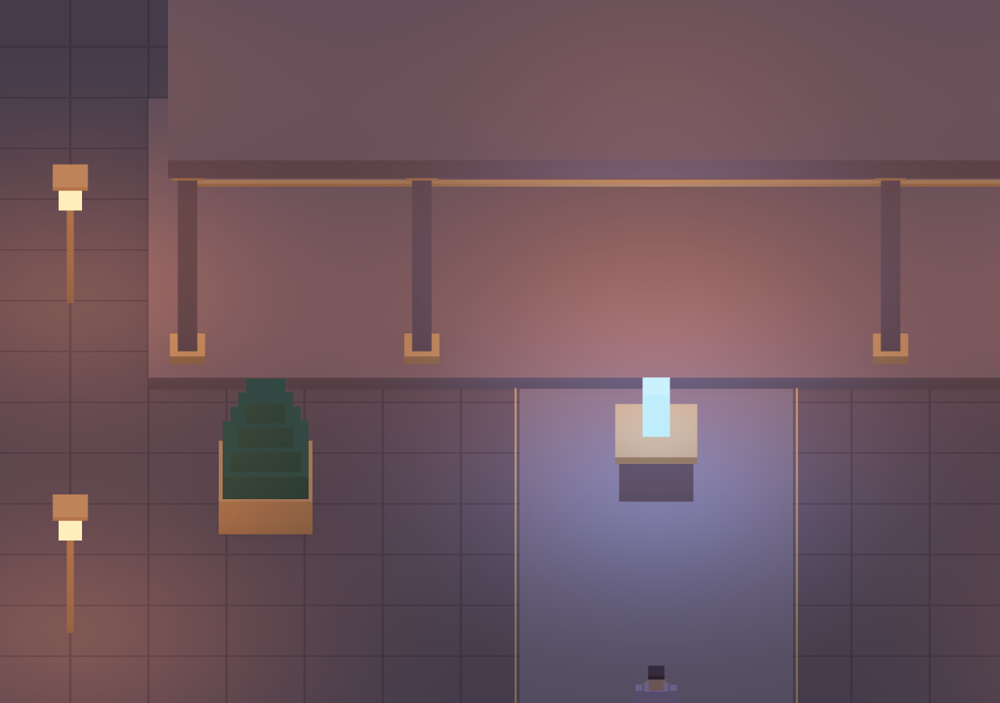

# Ambient occlusion — soft architectural grounding

The existing forward renderer now supports **Off**, **Geometry**, and **Geometry + screen**. Open **World directory → Ambient occlusion** to compare them. Geometry is the initial phone-sized-layout tier; the screen tier adds finer visible contacts. Direct lighting and emission retain their brightness.

[Self-contained HTML](../../../dist/ETRNLNINE-Atrium.html) · [Settings, ownership and source guide](../../decisions/0004-ambient-occlusion.md)

## Screenshots

The following closer views use the same engine, actual Atrium geometry, lighting, camera and stationary scene. Only the AO setting changes. They are browser screenshots, with no painted-in shading or image-generation step. The camera is closer than the interactive example's wide view to make contacts easier to inspect.

Without AO:

Geometry plus screen AO:

[Geometry-only detail](detail-geometry.png) · [Wide view without AO](amber-off.png) · [Wide view with AO](amber-screen.png) · [Portrait geometry-tier example](mobile.png)

## Verification

- **41 Node tests pass**, including AO setting validation, target dimensions, bounded proxy selection, world isolation and cleanup.
- Chromium checks pass with **zero WebGL/browser errors** and **zero runtime network requests** from the built HTML.
- In the controlled 800×600 pixel fixture, Geometry changes 21,238 pixels; adding screen contacts changes another 6,208. With ambient light set to zero, AO changes **zero RGB pixels**, preserving direct light and emission exactly in that fixture.
- Six screen/geometry cycles return live texture/framebuffer/program allocations to their starting counts. Forced framebuffer refusal releases partial allocations and falls back to Geometry. GPU context restoration recreates the three screen textures.
- Twelve scene replacements, ten world transfers, eviction/restoration, profiler controls and simultaneous portrait touch controls also pass. Portrait starts with Geometry selected.
- The 1280×900 close-up uses 640×450 AO targets: **2,592,000 estimated bytes**, with actual driver allocation unknown.

The milestone's [machine-readable browser results](browser-results.json) record pixel comparisons, fallback behavior, target budgets and lifecycle checks. Tests use Chromium software WebGL and emulated touch; physical-phone performance remains unmeasured. Built HTML contents are run with Canvas 2D rejection guards and zero runtime network requests because managed Chromium blocks direct file navigation.

The AO estimator is intentionally restrained and approximate. The geometry tier retains at most twelve box proxies; screen AO sees only visible depth/normal geometry and can miss small or hidden contacts. This is SSAO, not GTAO, and no cast-shadow, bloom or fog implementation is claimed. Estimated target storage is separate from requested GPU buffer bytes.
