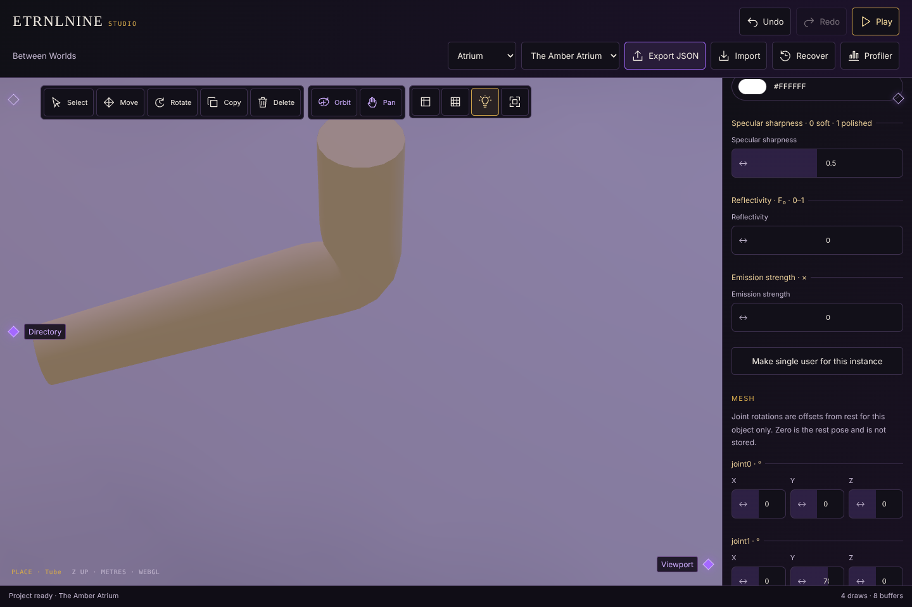

# Authored meshes and poses: evidence

Verification for [decision 0023](../../decisions/0023-authored-meshes-and-poses.md), run 2026-10-18 in the cloud container (Chromium with SwiftShader software WebGL). Software WebGL checks behaviour and pixels; it does not measure phone performance.

## Node (`npm test`): 118/118 pass

Six new tests in `tests/authored-meshes.test.js`:

- schema v4 validates recipes, mesh parts and poses against the generator catalog, and refuses unknown generators or versions, out-of-range, fractional or misspelled parameters, duplicate IDs, unresolved meshes, poses on missing parts or joints, non-unit quaternions and malformed pose maps;
- the tube's parameter catalog is the one source of defaults, limits and joint names;
- v3 ingress adds an empty mesh library without touching its source, and older versions refuse mesh data;
- equal recipes share one resident mesh across IDs and scenes; an edited recipe builds a new mesh, and the old one is freed only when its last scene lets go;
- a scene instance poses each skinned part from authored offsets with its own pose, returns to rest when the entry is removed, swaps mesh and skeleton on a recipe change while keeping runtime entity IDs, frees the replaced mesh, and refuses mesh parts without a renderer;
- placement and selection bounds measure mesh parts from rest bounds scaled by size.

## Browser (`npm run test:meshes`): passes

In the offline Studio build, starting from Atrium:

- *New tube mesh* adds a recipe with empty parameters and a one-part geometry source, and arms the place tool;
- placing stores no pose; setting joint1 Y to 70° stores exactly that quaternion as one command; undo removes it, redo restores it; setting it back to 0 removes `poses` from the JSON;
- setting the recipe's joints to 5 stores `{ "joints": 5 }`, rebuilds the mesh and shows the new joints; with joint4 posed, reducing joints to 3 is refused with an error and the document is unchanged;
- entering and leaving Play leaves the document byte-identical;
- no page errors and no network requests.

## Regression suites: all pass

`test:studio`, `test:studio-tools`, `test:objects`, `test:materials`, `test:surface`, `test:skinning`, `test:freelancer`, `test:browser`, `test:camera`, `test:studio-shell`, `test:viewport-ui`, `test:tool-fold`, `test:bloom`, `test:perspective`, `test:humanoid`.

`test:skinning` failed once while two suites ran in parallel: its animate-phase check waited a fixed 600 ms and the loaded software renderer drew only 3 frames. The check now waits for 6 frames (up to 15 s) and passes; the assertion itself is unchanged.
