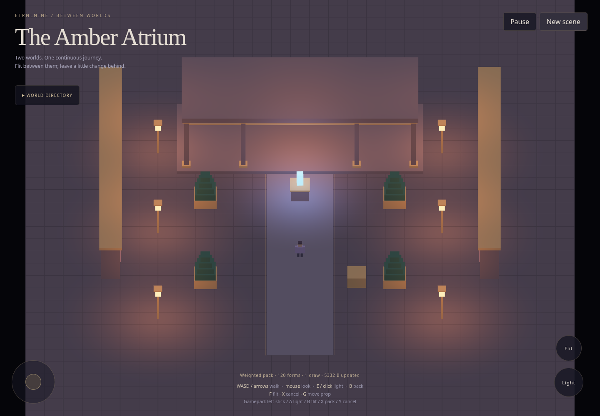
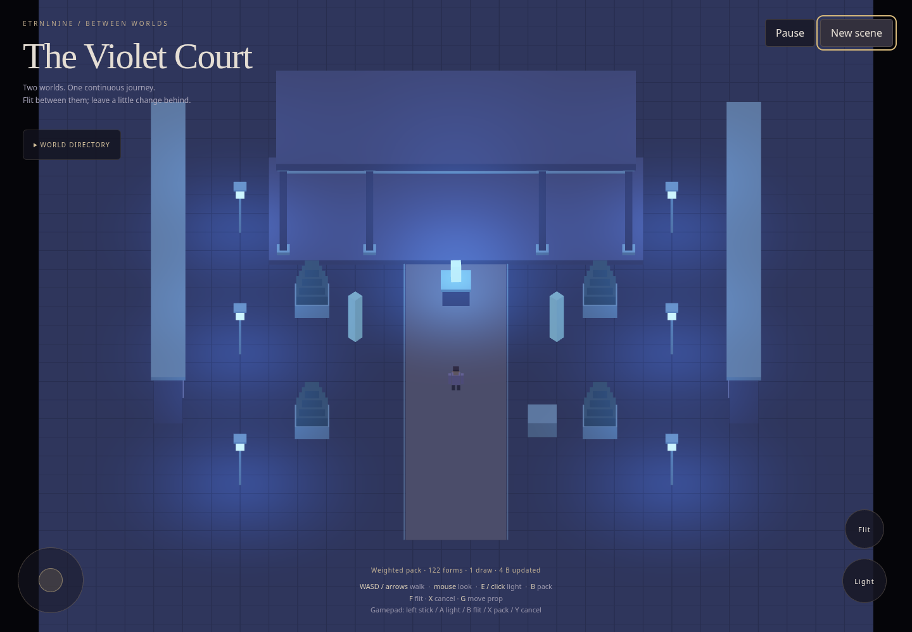
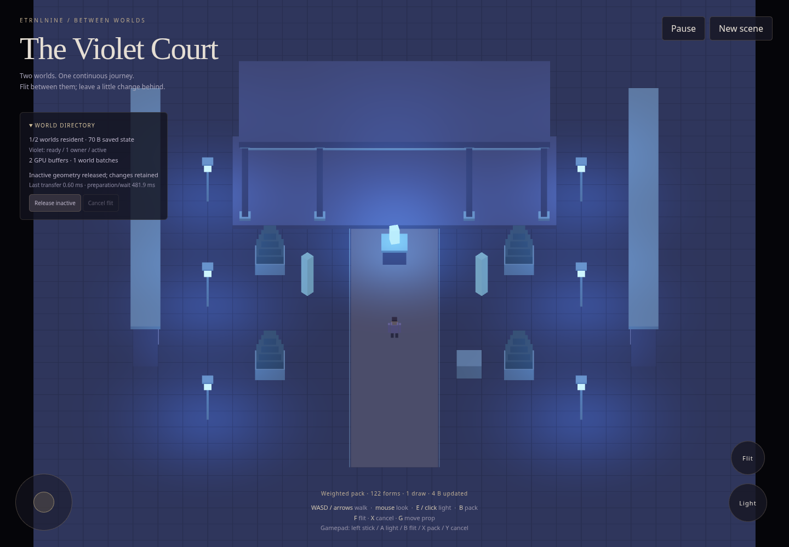
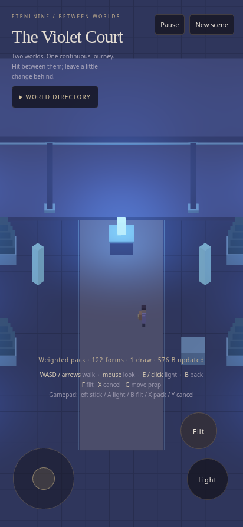

# Between Worlds — two-world flitting milestone

The Amber Atrium and Violet Court use the same engine and travelling actor. Each owns its geometry, collision data, lights and selected mutable state. Read the [decision record and editing guide](../../decisions/0002-between-worlds.md) for contracts and file responsibilities.

## Try it

Download [the single HTML](../../../dist/ETRNLNINE-Atrium.html) or serve the repo and open `examples/atrium/`.

1. Change the Amber light with E and move its prop with G.
2. Flit with F or the Flit touch button. The Violet world has its own state.
3. Open **World directory** and choose **Release inactive**. Observe one resident world and fewer GPU buffers, with compact saved state retained.
4. Flit back. The old world reconstructs with its changed light and prop position, and the same actor/equipment arrives.

Pending requests can be cancelled with X, standard gamepad Y, or the directory's Cancel flit button. A warmed destination can complete quickly; cancellation is only meaningful before the boundary commit. A blocked destination refuses transfer without moving the actor.

## Verification

- 27 Node tests pass, including hierarchy identity, refusal before mutation, boundary scheduling, moving-source mappings, cancellation/late results, shared preparation ownership, eviction/restoration, snapshot and preparation budgets, observer failure, safe stale cleanup, released-resource retention, and repeated cancellation of the real world factory after batch acquisition.
- Browser checks complete ten transfers with stable actor identity, independent realm state, and restoration after actual eviction. Twelve full scene replacements retain bounded live control/buffer counts.
- The built HTML runs with zero network requests and guards rejecting Canvas 2D, including off-screen preparation. Keyboard, focused-button activation, simultaneous touch pointers, touch flitting, and resizing are exercised.
- Isolated real-engine fixtures exercise destination collision refusal, cancellation before preparation starts, pause/resume, bounded readiness work, context restoration, unchanged-buffer uploads, and disposal.
- Two resident worlds use three GPU buffers total: one shared cube buffer and two instance buffers. Releasing the inactive realm leaves two. Scene disposal leaves only the renderer's shared cube; engine disposal leaves zero tracked GPU resources.

[Machine-readable browser results](browser-results.json) record timings and counts from this run. Waiting time includes frame scheduling; commit timing is only the synchronous transfer work. No real-phone frame-rate claim is made. This environment uses software WebGL and emulated touch; direct file URLs are blocked, so artifact contents execute directly in a page.

## Screenshots

Amber:

Violet:

Directory after releasing the inactive world:

Portrait after a touch flit:

## Remaining scope

This milestone prepares and evicts complete small world contexts. Large-world partition streaming, complete persistence/save files, off-world simulation, GRecorder, production traversal/body simulation, and final lighting/art fidelity remain future work. The source comments and decision records distinguish those goals from the working contracts demonstrated here.
