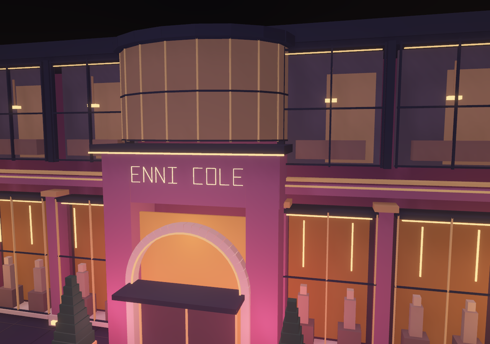
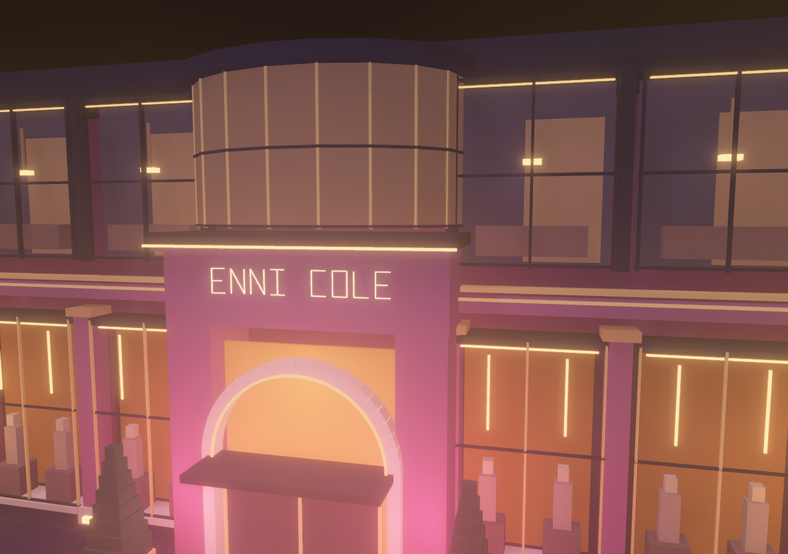
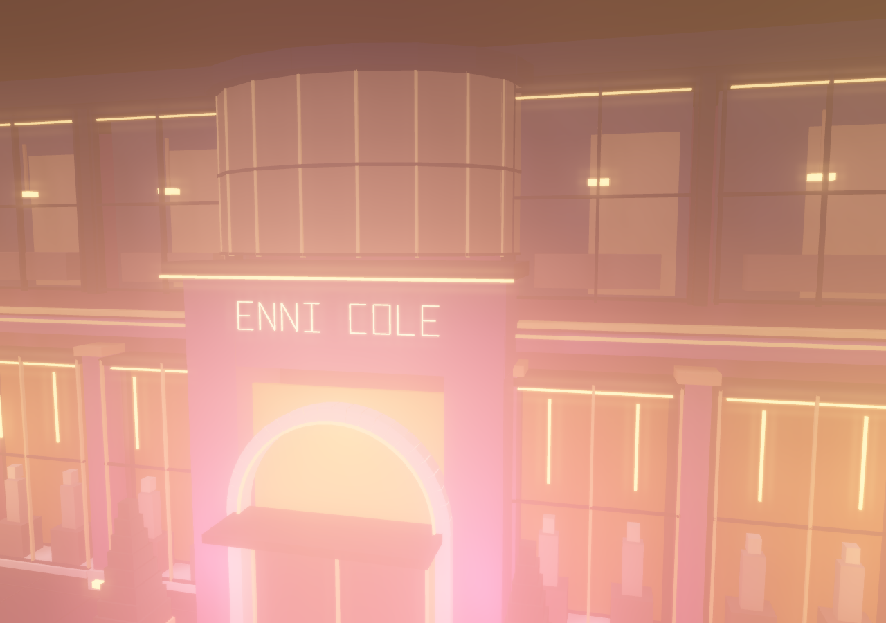
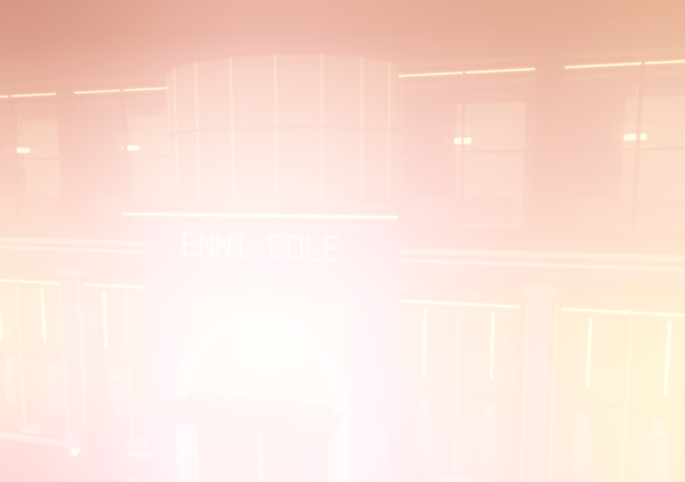

# Bloom tuning · an actual full range

Recorded 2026-10-16. [Controls, ranges and ownership](../../decisions/0014-bloom-art-direction.md) · [Offline Studio](../../../dist/ETRNLNINE-Studio.html).

Open **Image & effects → Bloom look** in Studio's View & guides menu or in Freelancer. Choose **Subtle**, **Luxe**, **Dream**, or **Full bloom**, then adjust strength, spread, scatter, haze, threshold and soft knee. Manual changes show Custom. Recipes keep exposure unchanged and preserve your current Soft/Fine quality; choosing a recipe while Off enables Soft. Exposure remains its own Presentation control.

## Matched captures

Every capture uses the same authored materials/lights, perspective camera, 1280×900 backing surface, Fine quality and exposure 1.25. Only bloom settings change. Full bloom intentionally demonstrates the washed, enveloping extreme; Luxe and Dream offer intermediate starting points. All are native WebGL screenshots.

| Subtle | Luxe |
| --- | --- |
|  |  |

| Dream | Full bloom |
| --- | --- |
|  |  |

[Phone, Soft quality with Luxe](phone.png). This is screen-space glow; actual volumetric fog remains a separate feature.

## Verification

- `npm test`: **85 passing** source contracts, including recipe matching, common bounds, atomic validation and existing allocation/lifecycle/migration/material contracts. [Output](node-tests.txt).
- `npm run build`: all three offline delivery files reproduce byte for byte. [Build identities](build.json).
- `npm run test:bloom`: native shader tests show **152,034 changed pixels** from haze alone and **196,608 / 196,608 changed pixels** for Full bloom versus matched zero strength, at constant exposure. The original strength-0.9 comparison affects **141,850** pixels. These are fixture measurements, not a portable quality score. Haze retains the same targets, two filter programs and 11 filter submissions in that fixture. All four facade recipes retain the existing filter and scene allocations. [Rendering/settings](render-results.json).
- Shared Studio/Freelancer UI checks pass all new numeric fields, Full/Subtle recipes, derived Custom state, exposure independence, JSON/history isolation, Play/Stop/restart and repeated quality disable. Zero runtime requests/page errors; Canvas2D guards remain active. [UI results](ui-results.json).
- Existing native checks still pass dark-threshold rejection, exposure, guides/depth, perspective + SSAO + cast shadows, resize, context restoration, unsupported-HDR fallback and full resource disposal.

- `npm run test:browser`: input/pause, 12 scene recreations, 10 world transfers, eviction/restoration, profiler buffer accounting, AO/shadow pixels and full cleanup pass. [Runtime results](runtime-results.json).

- `npm run test:studio`: numeric/history, valid/invalid file handling, recovery, walking and four clean Play/Stop cycles pass. [Studio results](studio-results.json).

The final `npm run test:bloom` rerun passes the shared shader kernel and explicit recipe refresh of a previously focused numeric field in both hosts. Existing defaults stay Subtle with haze zero and bloom initially Off. These tests use Chromium/SwiftShader and emulated touch, not physical-phone performance measurements.
