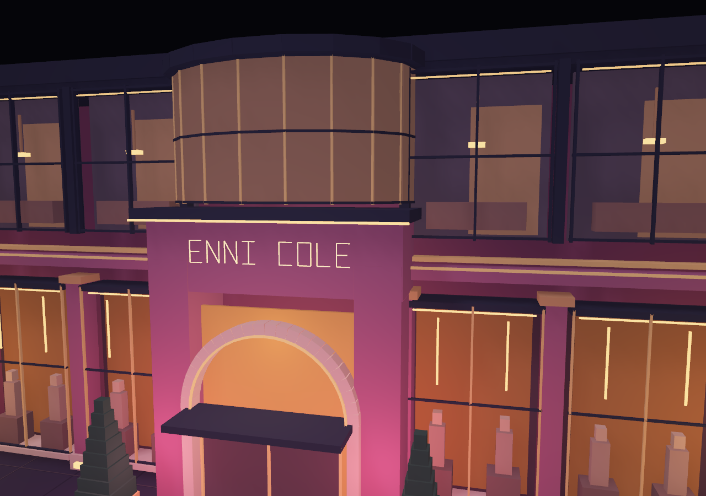
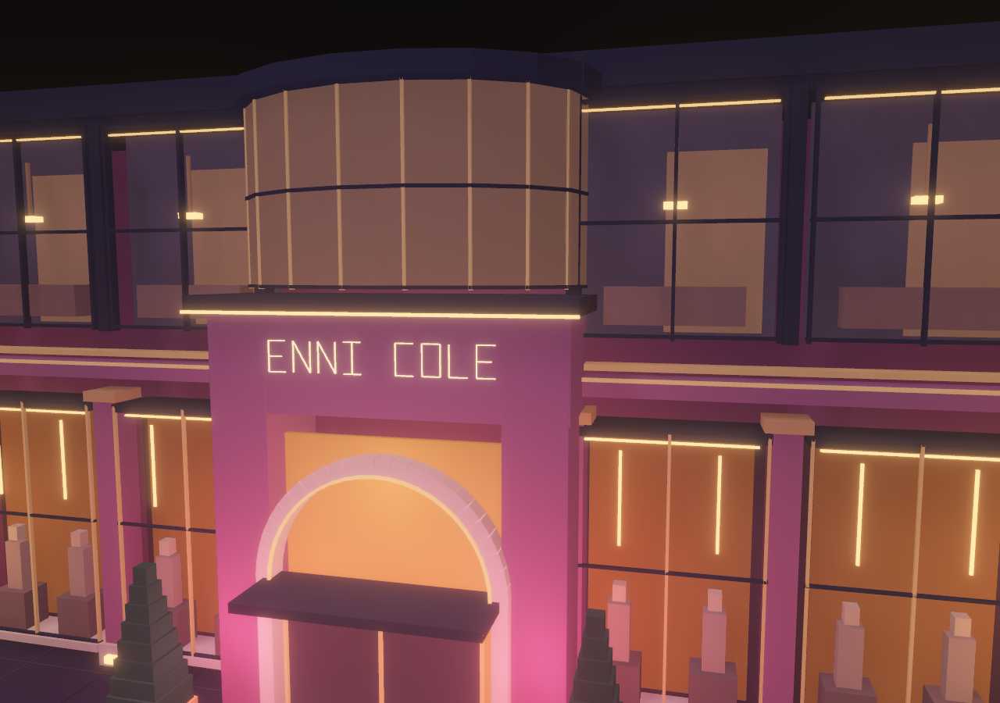
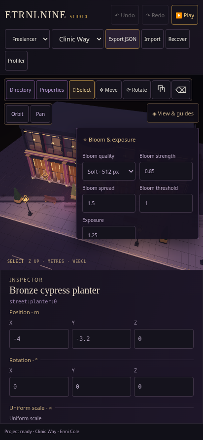

# Bloom · Enni Cole

Recorded 2026-10-16. Native WebGL2 HDR bloom is implemented in the shared renderer. [Controls, architecture, API and budgets](../../decisions/0012-hdr-bloom.md) · [Offline Studio](../../../dist/ETRNLNINE-Studio.html) · [Standalone Freelancer](../../../dist/ETRNLNINE-Freelancer.html).

Open **View & guides → Bloom & exposure** in Studio, or **Bloom & exposure** in Freelancer. Choose Soft or Fine. Both builds start Off, and Freelancer’s Low power choice turns bloom off too. Quality selection is explicit; no physical-phone speed is established here.

## Matched close-up

Same authored geometry/materials/lights, perspective camera and exposure (1.25). Fine, threshold 0.65, knee 0.6, spread 1.5, scatter 0.75. Only bloom strength changes from **0** to **1.25**. The zero-strength image retains the same HDR resolve/compositor, removing antialiasing-path changes as a comparison variable.

**Bloom off:**

**Bloom on:**

The sign, lamps and window strips seed soft halos while the architectural edges remain defined. This is bloom on the existing opaque procedural blockout, not a new material/interior/glass pass. Bloom is not volumetric fog or a claim of full Eevee equivalence. The next visual steps remain surface/material response and actual atmosphere/reflections.

[Wide view, zero strength](wide-off.png) · [Wide view, strength 0.85](wide-on.png) use the same wider camera and default threshold/spread/scatter, at exposure 1.25. [Phone viewport](phone.png) uses Soft with the close-up’s bloom settings. Camera/settings snapshots and target counts are included in [render results](render-results.json).

## Shared controls

[Desktop Studio preview](studio-desktop.png) uses the same widget. View settings stay outside project JSON/history/recovery and remain through Play/Stop and scene changes. Direct rendering remains available without HDR targets or additional programs. The panel reports actual readiness/fallback and estimated owned target memory.

## Verification

- `npm test`: **77 passing tests**. New contracts cover atomic settings/unknown keys, exposure state, bounded dimensions/storage, tiny targets, partial FBO/texture/renderbuffer failures, idempotent disposal and unsupported-HDR failure latching. [Output](node-tests.txt).
- `npm run build`: all three self-contained HTML targets build reproducibly. [Build identities](build.json).
- `npm run test:bloom`: real HDR pixel comparisons and offline Studio/Freelancer controls. [Rendering/lifecycle](render-results.json) · [Offline UI](ui-results.json). In the 512×384 fixture, bloom changes **141,850 pixels**; the dim scene below threshold changes **zero**. Exposure affects the rendered image. Zero strength skips the pyramid, leaving one compositor pass. These are fixture-specific counts, not portable quality scores.
- Guide checks produce exactly **192 foreground line pixels**, with no halo changes elsewhere. A line behind the floor changes **zero pixels**, checking that resolved depth supports normal guide occlusion after composition. HDR also renders with perspective, SSAO and cast shadows, with no GL error.
- Repeated frames reuse targets; resize replaces targets and preserves programs. Context restoration recreates HDR, repeated enable/disable cleans up, and forced float-colour unavailability reports one attempted allocation path across repeated frames before explicit retry. Off releases all optional targets/programs; full disposal returns buffer/program/VAO counts to zero.
- Offline UI tests run with Canvas2D rejection guards and zero runtime requests/page errors. Studio exports unchanged authored JSON and restores settings through Play/Stop. Freelancer preserves settings through restart; Low power opts out; both widgets survive repeated quality cycles.
- `npm run test:studio`, `npm run test:studio-tools` and `npm run test:freelancer` pass the established editor/history/files/recovery, touch authoring, guide lifecycle, keyboard doorway approach, three enter/return round trips, stable actor identity and scene ownership checks. [Studio](studio-results.json) · [Tools](tools-results.json) · [Freelancer](freelancer-results.json). The tools test now targets the view menu’s direct summary, avoiding ambiguity with the nested bloom section.
- The full runtime browser regression passes world recreation/transfers/eviction, input, profiler, shadow/AO pixels and lifecycle. [Results](runtime-results.json).

Local Chromium 154 uses SwiftShader and emulated touch. Screenshots and readbacks establish behavior, not physical-phone frame rate, battery use or hardware timing. The 1280×900 Fine capture estimates **71.77 MiB** of owned HDR/MSAA/pyramid storage; the 412×892 Soft capture estimates **22.89 MiB**. Those estimates exclude default framebuffer/driver overhead and are separate from requested instance/line-buffer bytes. At nonzero strength Soft/Fine submit at most 12/14 post draws plus one MSAA resolve; there is no extra runtime scheduler or production pixel readback.
