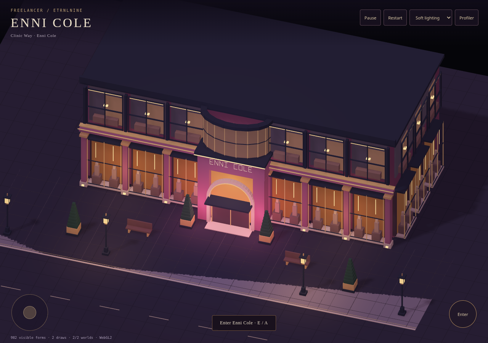
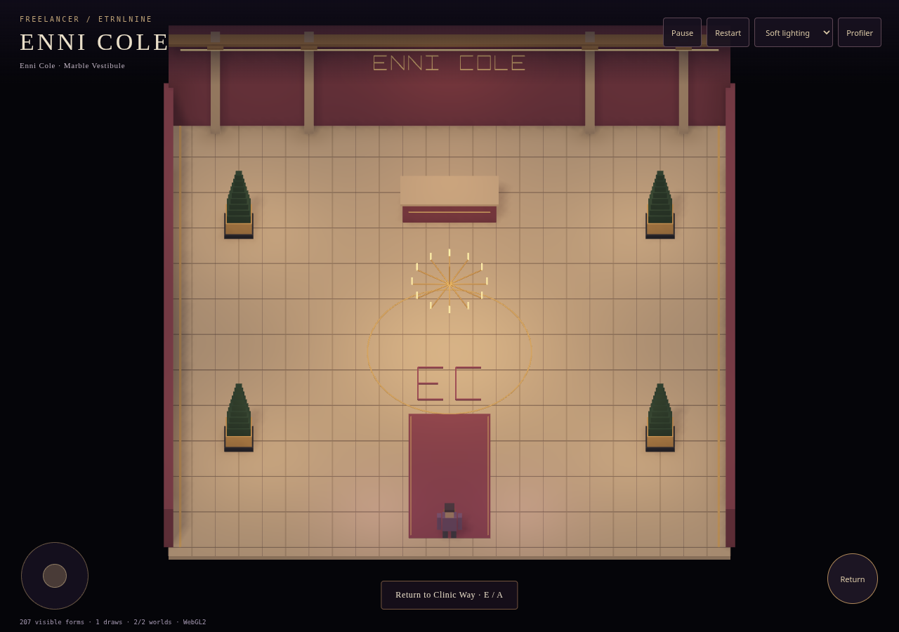
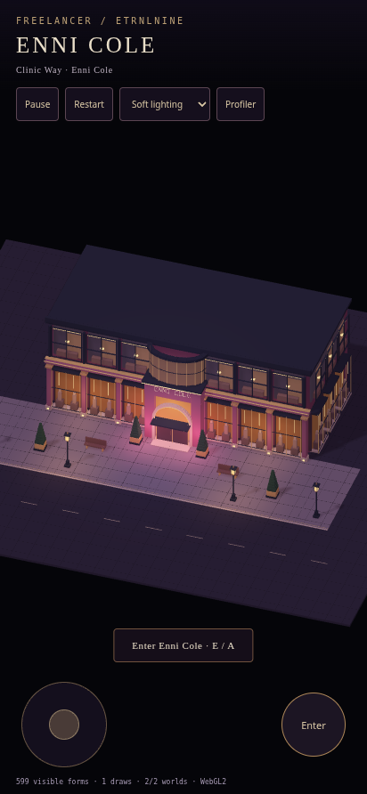
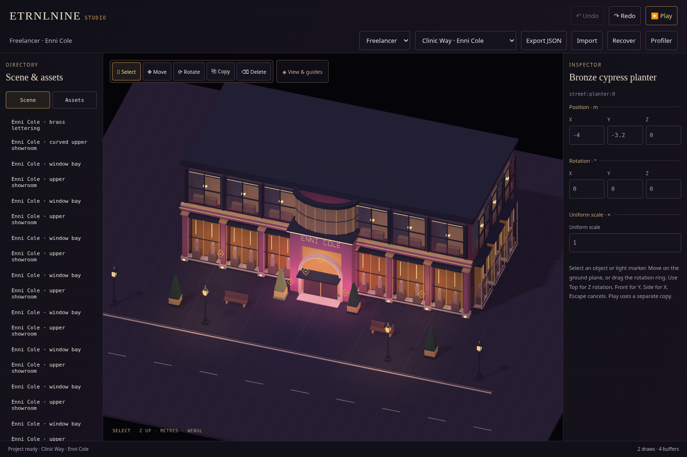

# Freelancer · Enni Cole street and vestibule

Recorded 2026-10-16. The first representative Freelancer content slice now runs inside ETRNLNINE and the shared Studio. This establishes a playable, editable street-to-store workflow; the full main game and the new articulated humanoid remain ahead.

[Download standalone game](../../../dist/ETRNLNINE-Freelancer.html) · [Download Studio](../../../dist/ETRNLNINE-Studio.html) · [Editing/source guide](../../../games/freelancer/DOCUMENTS.md) · [Architecture and limits](../../decisions/0009-freelancer-street-slice.md).

Download the HTML and open it in a WebGL2 browser. Both builds contain their data and need no CDN or sibling files. In Studio, choose **Freelancer** in the starter selector; the Scene selector switches between Clinic Way and the vestibule. Export or undo unsaved changes before changing starters. The shared recovery slot is best-effort, so keep JSON backups.

## Playable slice

Walk to the projecting arched entrance using WASD/arrows, a gamepad or the touch stick. Press E, gamepad A or the contextual Enter button. The marble vestibule is a separate prepared world; the same backpack traveler transfers at a simulation boundary and can return through the exit. Each transition needs a fresh press. Moving out of range while preparing, or a blocked arrival, refuses the transfer without changing source membership.

Nineteen reusable source assets compose 35 exterior placements and 11 interior placements. The street has rose masonry, champagne trim, a faceted curved upper showroom, native geometric lettering, amber display bays, pavement, planters, benches and lanterns. The cutaway vestibule has marble paving, a rose runner, EC floor medallion, concierge desk and chandelier. This is inspired by main's Enni Cole palette and the owner's photo; it is newly authored 3D content rather than an automatic port of legacy drawings.

## Screenshots

**Street · native 3D assemblies and the return interaction**

**Vestibule · separate world with the same traveler**

**Phone framing**

**Studio · the same package in the universal workspace**

## Verification

- `npm test`: **62 passing tests**. New coverage checks reciprocal doorway references, collision-safe spawns and arrivals, anchor transforms, spatial-grid queries/overflow, thin-wall movement/sliding and bounded native signage, and guide invalidation when reopening matching scene IDs. [Node results](node-tests.txt).
- `npm run build`: three offline targets; a repeated build produced identical bytes. [Build identities and sizes](build.json).
- `npm run test:freelancer`: actual keyboard approach and three enter/return round trips preserve actor identity, never exceed two resident worlds and make zero runtime requests. Out-of-range interaction and moving away during preparation are refused; a held gamepad A button cannot bounce through the arrival doorway. Studio selects Freelancer, opens both scenes, duplicates/undoes and runs isolated Play/Stop without changing exported JSON. Final disposal returns controls, jobs, definitions, records, worlds, buffers, programs and VAOs to zero. [Acceptance results](freelancer-results.json).
- The controlled source fixture records three idle render submissions with geometry AO and low sun shadows. Its final unchanged frame uploads **zero instance bytes**. [Profiler capture](profile.json) reports CPU submission work and requested resource storage; it is not a measured physical-device frame rate or GPU execution benchmark. Provider details describe capture-time state.
- Existing `test:studio` and `test:studio-tools` regressions exercise imports/recovery, touch editing, ring cancellation, light selection, history, isolated Play/Stop and guide restoration/disposal. [Studio results](studio-results.json) · [tool results](tools-results.json).
- Existing `test:browser` exercises AO/shadows, context restoration, input/pause, scene replacement, flitting and cleanup. [Runtime results](runtime-results.json).

Browser checks were run sequentially in headless Chromium 154 with SwiftShader. Touch viewports are emulated. Canvas2D is guarded against in the standalone acceptance run and existing regression suites. Physical-phone performance, battery use and driver compatibility remain unmeasured. GitHub Actions runs the source tests/build and uploads all three HTML files; it does not run these local browser checks or deploy a site.

## What remains

The current renderer uses opaque/emissive box surfaces with forward lighting, AO and cast shadows. Transparent/PBR glass, bloom, fog and wet-road reflections are not implemented. This slice is not a claim that the original Canvas art has been surpassed. The vestibule is a small destination exercise rather than the entire department store.

The existing diagnostic backpack traveler remains. The new procedural humanoid still requires the agreed front/side/three-quarter/gameplay-camera solid-silhouette review before detailed surfacing, followed by walking/turning and backpack readability. Full 3D contacts, stairs/parkour, populated departments and wider city streaming remain future stages.
