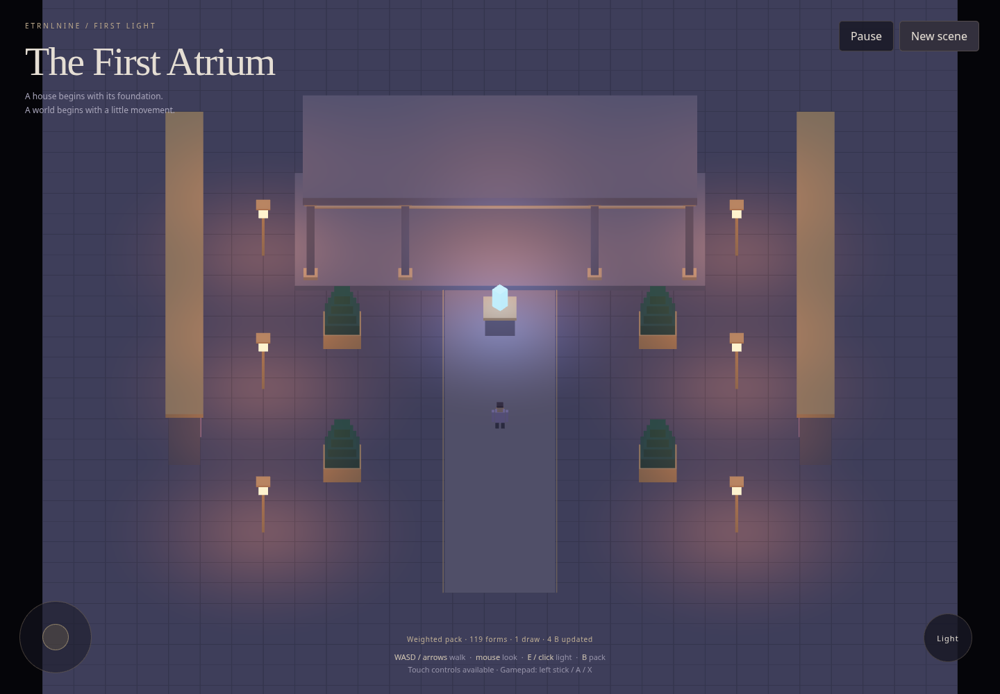
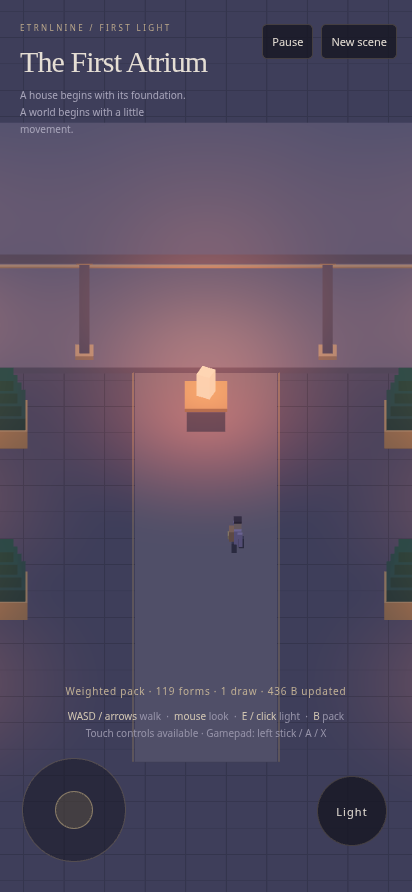

# First Light — initial runnable foundation

The first engine milestone contains the four house levels, a small ETRNLNINE composition root, and the independent Atrium example. Source is generously commented; start with the [decisions and editing guide](../../decisions/0001-first-light.md).

## Evidence

- Eleven Node tests pass: ownership, transforms, action input including short taps and simulated gamepad state, scheduler lifecycle, pause reasons, geometry, and architecture boundaries.
- Real Chromium runs the built HTML contents with a guard rejecting every Canvas 2D context request and zero network requests.
- Browser checks cover keyboard movement, action changes, focused-button keyboard activation, resizing, independent touch pointers, and twelve scene replacements without growth in live buffer/VAO/control counts.
- An isolated second primitive world exercises empty-engine startup, public registration, retained uploads, real GPU pixel output, context loss/restoration, and final disposal.
- A warmed unchanged batch uploads zero bytes. Changing the isolated box's x coordinate updates four bytes. The live actor/crystal scene intentionally updates changed instance data.
- Disposed engine counters report zero buffers/programs/VAOs/worlds/resources and no running loop. These counters and API checks are bounded-lifecycle evidence, not a measurement of a browser driver's total memory.

The [machine-readable browser result](browser-results.json) records the tested values. Browser tests use software WebGL, an emulated portrait viewport, and synthetic touch input. Physical gamepad hardware, real-phone speed, and direct file opening are not verified in this environment. Its browser policy blocks file URLs; the suite runs the unchanged embedded HTML contents and separately serves source modules on localhost.

## Screenshots

Desktop:

Portrait:

## Scope

The basic renderer uses retained instanced boxes, elevation-aware projection, procedural surface lighting, and conservative view culling. This is a functional foundation exercise, not the final art/lighting standard. Full procedural humanoids, GPU text, parkour, social awareness, world streaming/flitting, GRecorder, audio, bloom, and advanced materials remain planned work, with their intended ownership recorded in the engine plan.
