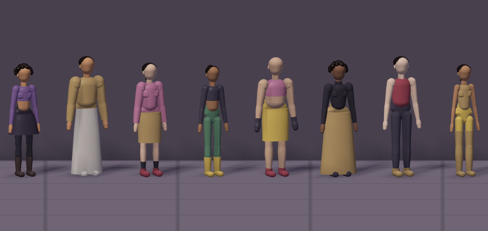
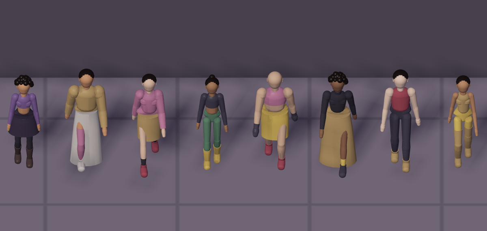

# Humanoid review · evidence

Recorded 2026-10-17. Contracts: [decision 0020](../../decisions/0020-humanoid-silhouette-review.md) (review stage) and [decision 0021](../../decisions/0021-rounded-bodies-and-garments.md) (rounded bodies and generated clothing). Open `dist/ETRNLNINE-Humanoid-Review.html` offline in a WebGL 2 browser.

| Turnaround, shaded | Silhouette, walking | Gameplay camera, 3× close-up |
| --- | --- | --- |
|  |  |  |

| Generated bodies and outfits | The same, walking under the game camera's elevation |
| --- | --- |
|  |  |

The first row comes from `npm run test:humanoid` on Chromium with SwiftShader at 1280×760. The second row is a source fixture: eight bodies across the three canons and six builds, each in an outfit drawn by `generateOutfit` from the Freelancer wardrobe with a seeded random and the night palette (949 first, in her preset). The look and outfits shown are proposals, not approved designs.

## Results

- `npm test`: 104/104 pass, including 6 humanoid tests.
- `npm run test:humanoid`: passes, including an outfit-slot change, Generate outfit, a body-canon change and a context loss/restore that reproduces the same silhouette pixels.
  - Silhouette pixel counts per view (front, three-quarter, side, back) at 640×360: preset (no pack) 7148 / 6366 / 4136 / 7146; with a pack 7325 / 7567 / 5431 / 7322; at 1.95 m 9599 / 8505 / 5546 / 9610.
  - Adding the pack adds the most pixels in profile.
- Regression suites: `test:browser`, `test:materials`, `test:surface`, `test:perspective`, `test:bloom`, `test:freelancer`, `test:studio`, `test:studio-tools`, `test:objects` and `test:camera` all pass. `test:studio` timed out once on its touch-walk step while other suites shared the machine, then passed when run alone.
- 949 in her preset outfit is 108 rounded and box parts. The review scene (5 figures, the traveler and guides) submits 4 draws: one per primitive stream in the lit pass, plus guides and shadows.
- No Canvas2D, network requests or page errors. GPU buffers stay bounded across view changes. Disposing the review leaves only the renderer's cube and rounded mesh; disposing the engine leaves nothing.

## Limits

Software WebGL only, so phone performance is unmeasured. Bodies are rigid rounded segments without skinning, IK or ground contact on slopes. Skirts and hair are static: legs pass through long skirts while walking until cloth chains are ported. The Freelancer street still uses the diagnostic traveler.
