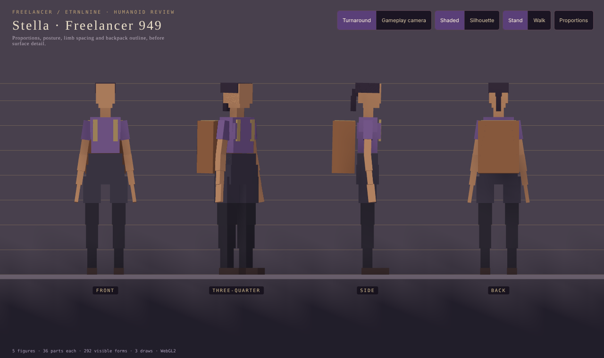
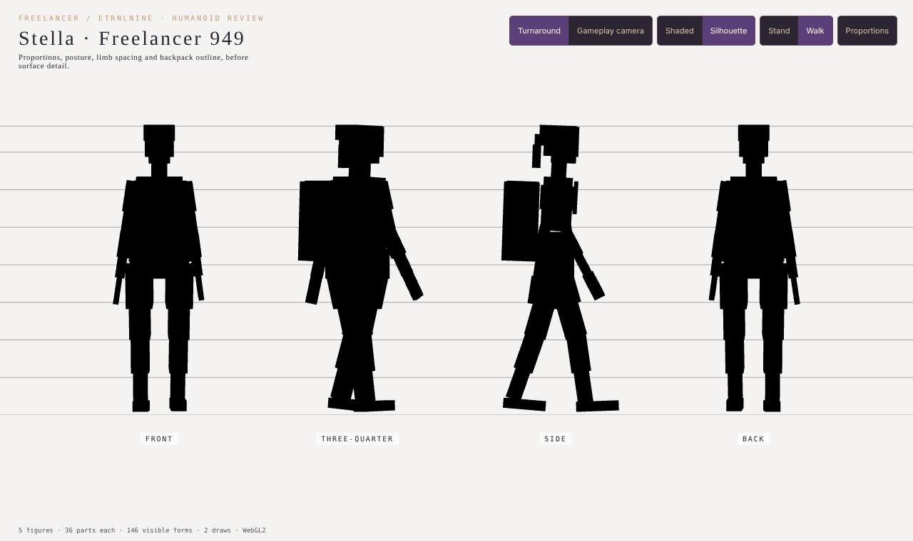
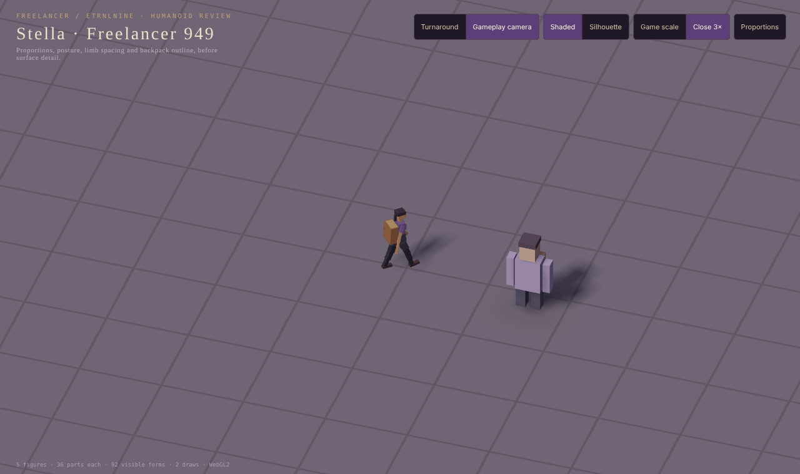

# Humanoid silhouette review · evidence

Recorded 2026-10-17. Contract: [decision 0020](../../decisions/0020-humanoid-silhouette-review.md). Open `dist/ETRNLNINE-Humanoid-Review.html` offline in a WebGL 2 browser.

| Turnaround, shaded | Silhouette, walking | Gameplay camera, 3× close-up |
| --- | --- | --- |
|  |  |  |

Screenshots come from `npm run test:humanoid` on Chromium with SwiftShader at 1280×760. The proportions shown are the starting 949 preset, not an approved design.

## Results

- `npm test`: 102/102 pass, including 4 humanoid tests.
- `npm run test:humanoid`: passes. Silhouette pixel counts per view (front, three-quarter, side, back) at 640×360: preset 6828 / 8819 / 5067 / 6845; without backpack 6582 / 7668 / 3754 / 6599; at 1.95 m 8103 / 10391 / 5859 / 8111. Removing the pack loses the most pixels in profile and three-quarter, as expected.
- Each figure is 36 boxes with the backpack and ponytail; the review scene holds 5 figures plus the diagnostic traveler in one batch, submitted in 2–3 draws including guides and shadows.
- No Canvas2D, network requests or page errors. GPU buffers alternate between the same two values across shaded/silhouette and view switches (shadow maps released and reacquired). Disposal leaves only the renderer's unit cube.

## Limits

Software WebGL only; phone performance is unmeasured. Bodies are box segments without skinning, IK or ground contact. The Freelancer street still uses the diagnostic traveler.
