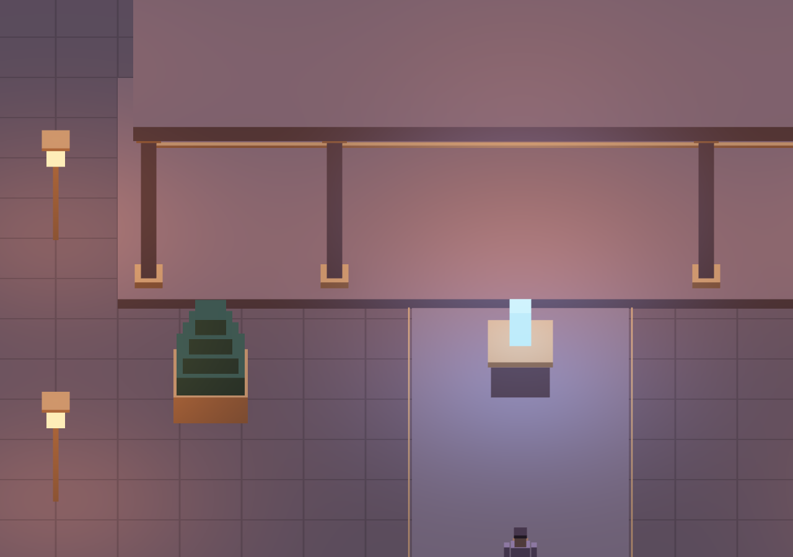
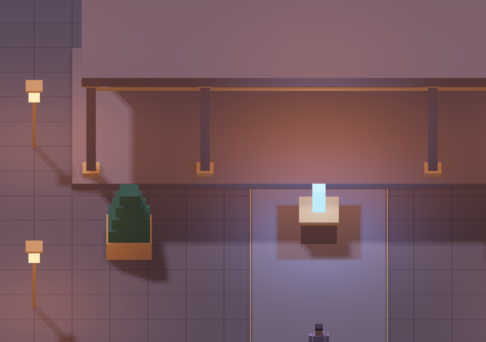

# Lighting — cast shadows in the forward renderer

ETRNLNINE now has configurable directional lighting, filtered cast shadows and one optional shadowed point light. Shadow storage/work is bounded and visible in the engine profiler. AO remains ambient-only; the corresponding direct light receives its shadow visibility.

[Self-contained HTML](../../../dist/ETRNLNINE-Atrium.html) · [Settings, source map, ownership and limits](../../decisions/0005-lighting-and-shadows.md)

## Try it

Open **World directory → Cast shadows**. Compare **Off / Soft / Fine**. Enable **Shadow the crystal light** for the optional cached local shadow cube. Move, change a light, move the prop with G, flit to the other world, or create a new scene. These use the same retained renderer, engine input system and runtime loop.

The reusable engine defaults shadows off. The example opts into the lower-cost directional map and leaves local shadows off until selected. Quality selection remains independent of AO.

## Screenshots

Identical Atrium geometry, pose, camera and lighting; AO stays on Geometry. The comparison changes only shadow settings. These are actual browser screenshots, without painted shading or image generation. The close-up uses a 24-unit sun half-extent to match its smaller view.

Cast shadows off:

Filtered sun plus the selected crystal-light cube:

[Lower sun resolution](detail-low.png) · [Interactive wide view](desktop.png) · [Portrait example](mobile.png) · [Profiler](profiler.png)

## Verification

- **45 Node tests pass**, covering foundational contracts, lighting authoring, directional/cube projections and partial depth-target cleanup.
- Full Chromium checks pass with **zero browser/WebGL errors** and **zero runtime network requests** from the offline HTML.
- A controlled 800×600 fixture changes **15,243 pixels** with sun shadows and **78,259 pixels** with the selected point cube. Neither brightens pixels. A flat receiver alone changes **zero pixels**, guarding against self-shadow speckling.
- Offscreen geometry is excluded from the camera batch and included in the caster batch. Static maps reuse depth with zero shadow draws; changed geometry invalidates the sun map. Material recoloring does not redraw depth.
- The point cube reuses static depth, throttles moving casters, and refreshes all six faces when due. Moving the light or changing worlds refreshes immediately; changing light color does not redraw depth.
- Source-batch disposal immediately returns borrowed caster CPU/GPU storage to zero. Disabling shadows releases depth targets. Actual GPU-context restoration recreates both sun and point maps, alongside AO.
- Twelve scene replacements, ten world transfers, eviction/restoration, profiling and simultaneous portrait touch inputs remain working.

[Machine-readable browser results](browser-results.json) accompany the screenshots. Verification uses Chromium software WebGL and synthetic touch, not physical-phone hardware. The offline HTML contents run directly because the managed browser blocks file URLs, with Canvas 2D rejection guards and zero runtime network requests.

Directional coverage is finite; there are no cascades. Local shadow updates are intentionally rate-limited when only geometry moves, so the selected cube can lag moving actors by its configured refresh interval. Only one point light receives a shadow cube. Other point lights remain unshadowed. Fixed PCF softens edges without claiming physical area-light penumbras, and a separate screen-space contact-shadow pass is not implemented. Physical-device performance and hardware timing remain unmeasured.
