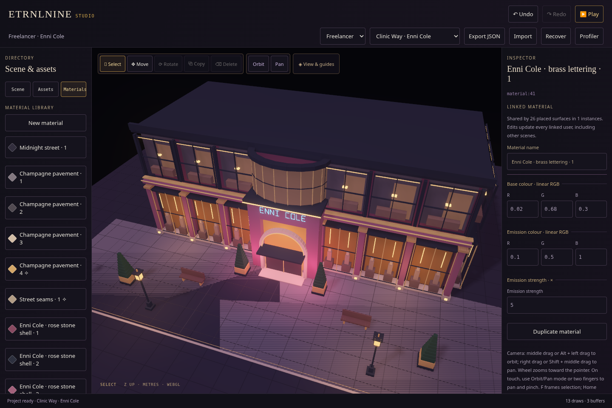

# Linked materials and shared presentation

Recorded 2026-10-16. [Architecture and current limits](../../decisions/0013-presentation-and-materials.md) · [Offline Studio](../../../dist/ETRNLNINE-Studio.html) · [Freelancer](../../../dist/ETRNLNINE-Freelancer.html).

## Editing

Open **Materials** in Studio's library. Selecting a definition opens the shared contextual inspector: name, linear base RGB, independent emission RGB and emission strength. A usage notice counts placed surfaces and instances across all scenes. Every linked user updates together.

Alternatively, select an object in **Scene**, choose its **Surface part**, and assign an existing material. **Make single user for this instance** duplicates the definition and redirects the matching parts in that placement. Other placements retain their original material. These operations use normal undo/redo, cancellation, JSON export/import and detached Play data.

This milestone edits the actual diffuse/emissive material supported by the shader. Scenes currently assemble instances of a shared cube mesh; arbitrary imported meshes, face slots, textures, transparency and PBR surface response remain future work. Emission supplies independent HDR surface radiance and bloom, without automatically lighting neighbouring objects.

## Preview

This acceptance-test edit changes the sign's emission to `[0.1, 0.5, 1]` at strength 5 while retaining separate base colour. Soft bloom displays the emitted radiance. The contextual inspector shows the shared definition and 26 placed surface users. The packaged source retains its authored palette; this screenshot is a live document edit.

[Phone viewport and contextual inspector](studio-phone.png). Both captures are native WebGL geometry with HTML editing controls, not generated artwork.

## Ownership

**Presentation** owns scene HDR/MSAA/depth, exposure and final composition. **Bloom** owns only its filter pyramid/programs and borrows scene colour. HDR can run with bloom completely Off; changing bloom quality retains the shared scene allocation. **Image & effects** is the single shared Studio/Freelancer control template. View preferences stay outside authored JSON.

Project schema 2 links parts to material IDs and supports placement overrides. Validated legacy projects migrate once on ingress, preserving IDs, geometry and emitted radiance. Runtime material copies are lazy and scene-owned. Live edits retain geometry identities; depth-only shadow records remain material-independent.

## Verification

- `npm test`: **84 passing tests** covering material contracts/migration, shared runtime identity, private bindings/history, validation/prototype IDs, cancellation cleanup, independent presentation settings and existing engine contracts. [Output](node-tests.txt).
- The authored JSON conversion round-trips exactly to both previous files: **157 Atrium shaped parts / 47 materials**, **438 Freelancer shaped parts / 72 materials**. Original scenes, geometry, IDs, transforms and emissive radiance are unchanged. [Source migration](source-migration.json).
- `npm run test:materials`: native pixel tests, independent HDR/filter ownership and forced filter-allocation failure/recovery pass. The fixture changes **zero colour-channel samples** when an unlit emitter's base changes, and **16,262** when its emission colour changes. Explicit HDR survives Bloom Off and filter refusal; failure attempts stay latched at one; explicit retry recovers. GL error and final buffer/program/VAO counts are zero. The offline editor passes linked edits, private overrides, cancel/history, creation/rename/duplication/per-part assignment, export/import and detached Play, with zero requests/page errors. [Results](material-results.json).
- `npm run test:bloom`: native bloom pixels/exposure/guide depth, HDR with perspective/SSAO/shadows, resize, context restoration and capability fallback pass. Shared Studio/Freelancer controls pass quality cycles, viewport-only settings, Play/Stop/restart and Low power release, with zero requests/page errors. The Auto HDR resource assertion waits for the coordinator's next frame, independently of immediate filter disable. [Rendering](bloom-render-results.json) · [Shared controls](bloom-ui-results.json).
- All three offline HTML outputs build reproducibly. [SHA-256 identities](build.json).
- `npm run test:browser`: full runtime input, 12 scene recreations, 10 world transfers, eviction/restoration, profiler, AO/shadow pixels and final cleanup pass. [Results](runtime-results.json).
- `npm run test:studio`: existing numeric/history, export/import/recovery and four clean Play/Stop cycles pass. [Results](studio-results.json).
- `npm run test:studio-tools`: grid/light-marker selection, light editing, placement/copy/delete/undo, rotation and touch cancellation pass. [Results](tools-results.json).
- `npm run test:freelancer`: real keyboard approach, three doorway round trips, stable actor identity, editor data/Play and full disposal pass. [Results](freelancer-results.json).

Chromium 154 uses SwiftShader and emulated touch: these checks establish behavior and rendering, not physical-phone performance.
