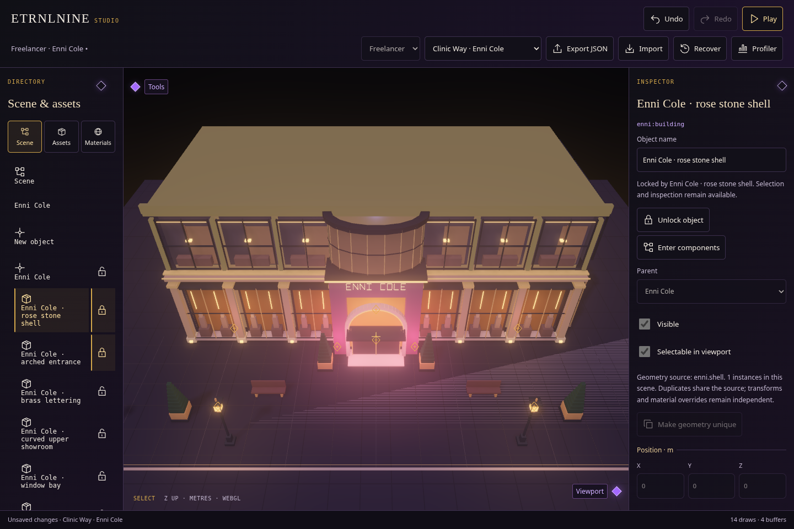

# Studio · origins, locks and precise sliders

[Implemented contract and remaining modeling work](../../decisions/0019-origins-locks-and-number-surfaces.md) · [Offline Studio](../../../dist/ETRNLNINE-Studio.html).

**New object** starts with an empty origin. Enter its components through the breadcrumb,
then place assets to attach geometry. Copy duplicates linked branches; **Make geometry
unique** separates one component's source. Parent changes preserve world transforms.

Enni's shell and entrance remain locked initially, but they can now be selected and
inspected. Closed, open and inherited padlocks explain the state; unlock the responsible
object to edit it. Selecting a roof or other component surface opens its actual material
part. Position fields remain precise numbers; naturally bounded fields combine a slider
track with an editable number. Escape cancels an edit; each completed gesture is one undo.

## Previews

[Phone material sliders](number-phone.png) · [Phone appearance controls](appearance-phone.png).

## Verification

**98 source tests and 11 browser acceptance suites passed** using Chromium/SwiftShader.
[Command results and durations](regressions.json) · [source-test output](node-tests.txt) ·
[identical repeat-build hashes for all three offline HTML files](builds.json).

| Acceptance | Recorded result |
| --- | --- |
| Origin creation, attachment, linked branches, unique geometry, inherited locks, contextual picking, parented tools and precise numeric transactions | [Objects and controls](objects-and-controls.json) |
| Rendering, repeated world switches, input/pause, profiler, context restoration, AO/shadows and resource cleanup | [Runtime](runtime.json) |
| Import/export, undo/redo, Play isolation and lifecycle | [Studio](studio.json) |
| Placement, copying, removal, rotation and touch cancellation | [Authoring tools](tools.json) |
| Orbit, pan, zoom, framing and cancellation | [Camera](camera.json) |
| FOV validation, guide ownership, responsive panels and Play restoration | [Viewport](viewport.json) |
| Shared/private materials, emission, assignment, renaming and round trips | [Materials](materials.json) |
| HDR color, color-modal cancellation, shortcut isolation and surface rendering | [Surface/color](surface.json) |
| HDR bloom, art-direction recipes and shared Studio/game widgets | [Bloom](bloom.json) · [Appearance UI](appearance.json) |
| Street gameplay, portal boundaries and editor integration | [Freelancer](freelancer.json) |
| Perspective navigation, authoring tools, rendering and restoration | [Camera](perspective-camera.json) · [Tools](perspective-tools.json) · [Rendering](perspective-rendering.json) |

The focused packaged-Studio acceptance blocks Canvas 2D and records zero browser errors
and zero runtime network requests. Source JSON/export use schema version 3; legacy
version 1/2 ingress remains covered by source tests. Origin markers deliberately retain
the shared foreground guide layer when axes and selection outlines are hidden.

The current backend remains native instanced box geometry. Arbitrary mesh modeling and
parented light/audio components are follow-on capabilities, not claimed implementations.
Tests use software WebGL and emulated touch; physical-phone speed remains unmeasured.
