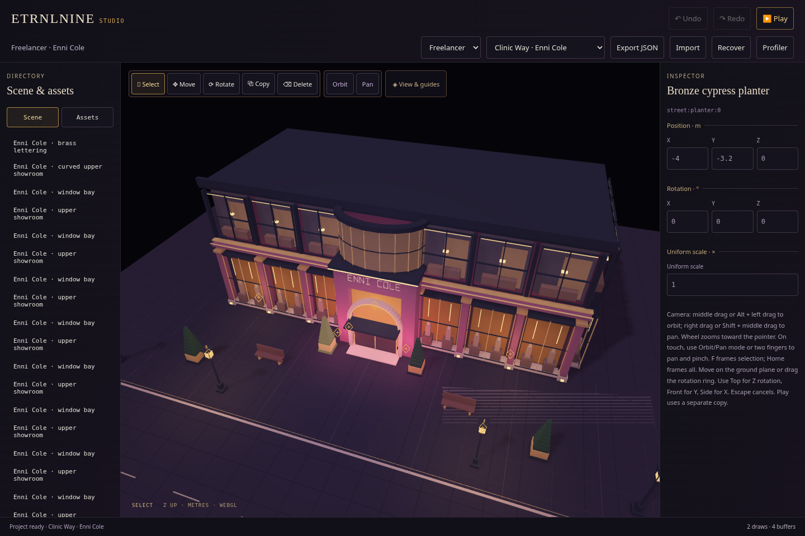
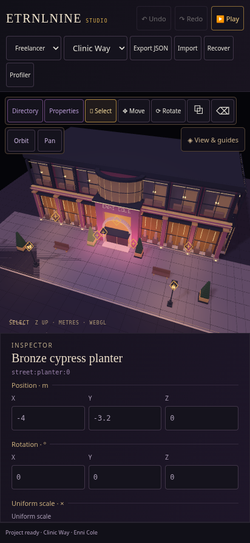

# Studio · perspective

Recorded 2026-10-16. **View & guides → Perspective** selects the second lens, with adjustable vertical FOV. Both lenses share the renderer, clipping/picking, camera navigation and authoring tools. [Download Studio](../../../dist/ETRNLNINE-Studio.html) · [Camera API, ownership and next bloom/lighting milestones](../../decisions/0011-perspective-camera.md).

These show the existing authored street through a perspective camera. Bloom is not implemented here; the building remains the current procedural blockout. The next visual milestone is linear HDR multiscale bloom, retaining crisp architectural edges while testing a broad, ethereal halo. These screenshots are not a final material/atmosphere demonstration or a claim of surpassing the reference.

## Verification

- `npm test`: **73 passing tests**. Independent matrix multiplication and inverse checks, project/ray agreement, near/far/behind-eye clipping, conservative frustum intersections, cursor anchors/pan in named views, portrait bounds framing, lens/pose restoration and depth-aware guide draw/pick behavior. [Output](node-tests.txt).
- `npm run build`: all three offline HTML targets rebuilt. [Reproducible build identities](build.json).
- `npm run test:browser`: the existing complete runtime suite passes world switching/eviction, keyboard/touch input, profiling, AO/shadow pixels, context restoration and resource lifetime. [Results](runtime-results.json).
- `npm run test:studio` and `npm run test:studio-tools`: existing edit/history/file/recovery, repeated Play/Stop, marker/placement/rotation/cancellation and guide-resource checks pass. [Studio](studio-results.json) · [Tools](tools-results.json).
- `npm run test:camera`: the original orthographic mouse/touch navigation suite passes too. [Results](orthographic-camera-results.json).
- Perspective native mouse/touch acceptance checks orbit, pan, wheel/pinch, Escape/touch cancellation, F/Home framing, second-finger rollback of a live object Move, JSON/history isolation and complete lens restoration after Play. Canvas2D requests throw; the offline page makes zero runtime requests and reports no page errors. [Camera results](camera-results.json).
- Perspective authoring also passes actual light selection/movement, asset placement/ground offset, duplicate/delete/undo, snapped rotation/cancellation and repeated Play/Stop. [Results](perspective-tools-results.json). The camera, tools and rendering fixtures are the three components of `npm run test:perspective`, executed sequentially.
- Perspective controlled rendering changes **6,454 sun-shadow pixels**, **10,864 point-shadow pixels**, **7,784 geometry-AO pixels**, and **2,791 screen-contact pixels** in the 640×480 fixture. Offscreen casters stay eligible, unchanged shadow maps stay cached, context restoration retains the lens and renders geometry again, and optional targets and all GL buffers/programs/VAOs release. [Results](render-results.json). Pixel counts identify this fixture/driver, not portable thresholds or quality scores.

The Node/packaging checks run in GitHub Actions too; browser checks are local Chromium 154/SwiftShader with emulated touch. They verify behavior and resource lifetime, not physical-phone speed, memory pressure or hardware-driver compatibility. Perspective adds no render targets or runtime animation loop; the optional AO and shadow budgets remain unchanged. Shadow coverage is still a bounded focus-centered sun map, with one optional point cube; it does not cover an entire perspective frustum automatically.
