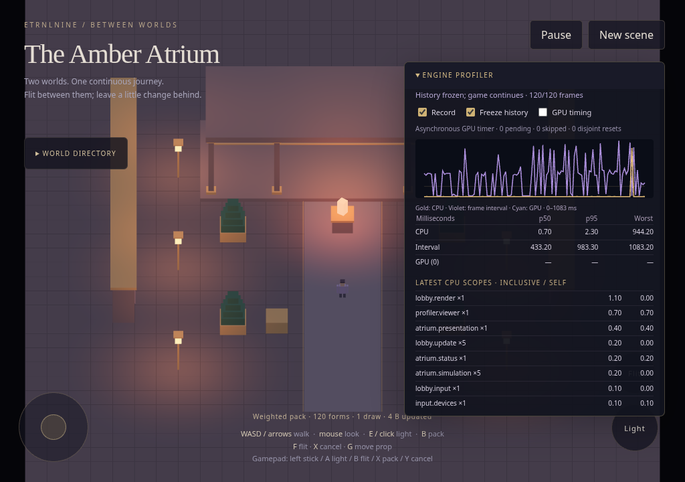
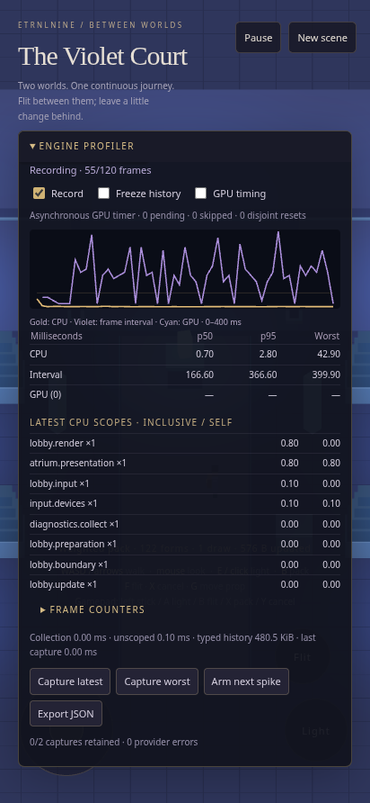

# Engine profiler — integrated diagnostics milestone

The engine now has a bounded recorder in Basement, instrumentation in Lobby, ownership reporting in Directory, and a reusable inspector in Penthouse. The example supplies game labels and instantiates the inspector through the same library interface as other tools.

[Downloadable HTML source](../../../dist/ETRNLNINE-Atrium.html) · [Decisions, source map and API examples](../../decisions/0003-profiler.md)

## Try it

1. Open **Engine profiler** at the upper right.
2. Walk/flit, change a light, release an inactive world, or create a new scene. Inspect frame intervals, CPU scopes, preparation work and resource counters.
3. Freeze history while continuing to move. Capture the latest or worst retained frame.
4. Expand **Latest capture details** to inspect resource owners and scope spans, or export JSON.
5. Turn recording off and on independently of game pause. Optional GPU timing is enabled only if the context supports it.

## Evidence

- 39 Node tests pass, including inclusive/self timing, repeated fixed steps, percentiles/expiry, registry/span/depth/capture limits, disabled clock reads, frozen history, provider failure isolation, copied captures and GPU query lifecycle/disjoint behavior.
- Browser checks run the actual HTML with Canvas 2D rejection guards and zero network requests, retaining the previous movement/touch/world reconstruction tests.
- The inspector freezes/disables recording while game time advances, retains at most two captures, exports parseable JSON with correct requested buffer bytes and named owners, and fits an emulated portrait viewport.
- Five viewer create/open/dispose cycles remove their DOM and runtime subscriptions. Engine disposal removes providers, history and optional query objects. Rejected startup budgets also leave no allocated GL buffers/programs or window listeners behind.
- Actual renderer preparation uploads remain counted when the later draw uploads nothing; the GL error check remains clear.

[Machine-readable browser results](browser-results.json) and a [sample exported capture](sample-capture.json) accompany the screenshots. GPU availability and completion counts describe this context only. Software WebGL timings are diagnostic evidence of operation, not real-phone performance measurements.

## Screenshots

Desktop inspector:

Portrait inspector:

## Measurement limits

CPU work, frame intervals and optional GPU execution are separate measurements. Requested buffer bytes exclude browser/driver heaps and default framebuffer storage. Historical captures label current owner details as capture-time data. The profiler is diagnostic instrumentation, not GRecorder replay or a replacement for browser/device profiling tools.
