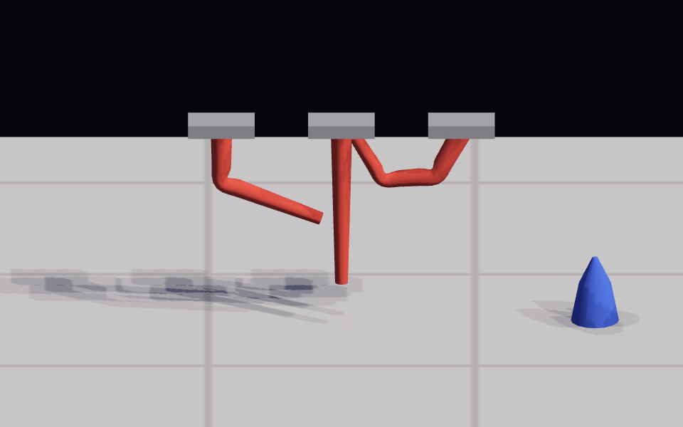

# Skinned meshes · evidence

Recorded 2026-10-17. Contract: [decision 0022](../../decisions/0022-skeletons-and-skinned-meshes.md).

`npm run test:skinning` captured this on Chromium with SwiftShader at 960×600. It shows one shared tube mesh in three poses:

- **Left:** the middle joint is bent.
- **Centre:** the rest pose.
- **Right:** every joint is bent.

The blue cone beside them is a rigid lofted mesh. Sun shadows and screen-space AO are on, and the shadows on the floor come from the skinned depth pass.

## Results

- `npm test`: 112/112 pass, including 8 skinning tests.
- `npm run test:skinning` passes. Its checks:
  - Bending the middle joint moves the silhouette's centre about 53 px and raises its lowest point 127 px.
  - The bend refreshes the sun shadow map, and an unchanged pose keeps the cached map with identical pixels.
  - Context restoration reproduces the bent frame exactly.
  - The real frame loop alternates animate and render.
  - Cleanup leaves zero buffers, VAOs, programs and palettes.
- Regression suites: `test:browser`, `test:materials`, `test:surface`, `test:bloom`, `test:perspective`, `test:camera`, `test:objects`, `test:humanoid`, `test:freelancer`, `test:studio`, `test:studio-tools`, `test:studio-shell`, `test:viewport-ui` and `test:tool-fold` all pass.

## Limits

Software WebGL only, so phone cost is unmeasured. Linear blend skinning can thin a joint under extreme twist. Picking uses rest bounds. No game or Studio surface uses skinned meshes yet.
