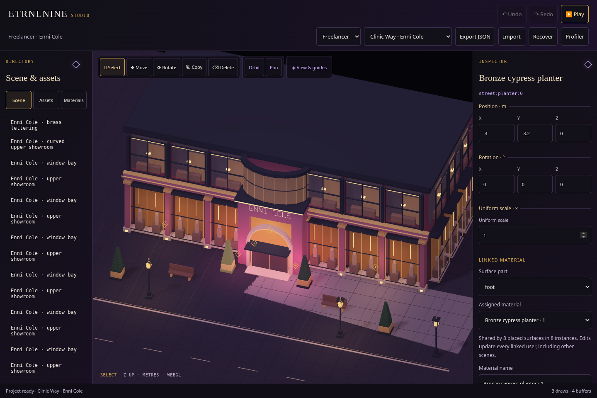
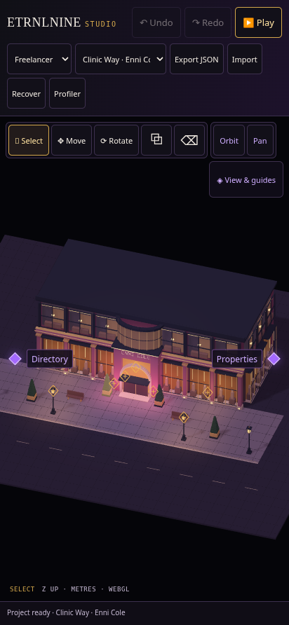

# Studio · DFAB diamonds

[Architecture and controls](../../decisions/0015-studio-diamond-shell.md) · [Offline Studio](../../../dist/ETRNLNINE-Studio.html).

Use the labelled violet diamonds at the viewport edges to open **Directory** and **Properties**. The outlined diamond in an open panel folds it away. Desktop panels can open independently; phones use one sliding panel at a time. Labels and diamonds share a large native-button touch target. Keyboard activation and reduced motion are supported.

The shared palette restores DFAB's near-black surfaces, violet interaction and gold selection, with more readable property text. Studio keeps one contextual inspector for transforms, lights and materials. Panel visibility stays outside authored JSON/history, and Play restores the editing layout on Stop.

## Previews

Desktop workspace with independently collapsible panels:

Phone viewport with collapsed, labelled diamonds:

[Directory/material library](phone-directory.png) · [Contextual material properties](phone-properties.png).

## Verification

- **Desktop/phone shell acceptance:** [state, accessibility, document isolation and lifecycle](shell.json) · [log](shell.txt).
- **86 Node tests pass:** [unit output](node-tests.txt).
- **All three offline builds reproduce byte-for-byte:** [SHA-256 hashes](builds.json).
- **Studio editing/recovery/Play:** [acceptance log](studio.txt).
- **Authoring tools:** [placement, light selection/movement, duplicate/delete/undo, rotation and guide lifecycle](tools.json).
- **Camera controls:** [mouse/touch navigation, second-finger rollback, cancellation and Play restoration](camera.json).
- **Shared bloom controls:** [Studio and Freelancer, two cycles each with no page errors or runtime requests](appearance.json).

The offline build embeds the maintained local CSS files. Unit checks validate self-contained stylesheets and reject hidden dependencies. Browser checks cover desktop/phone control state, labels, touch size, focus/keyboard, independent layouts, Play restoration, stable phone canvas size, unchanged documents and widget disposal/remount. Existing Studio/tools/camera and shared appearance workflows are checked against the redesigned shell.

Chromium uses SwiftShader and emulated touch. These results establish behavior and screenshots, not physical-phone performance.
