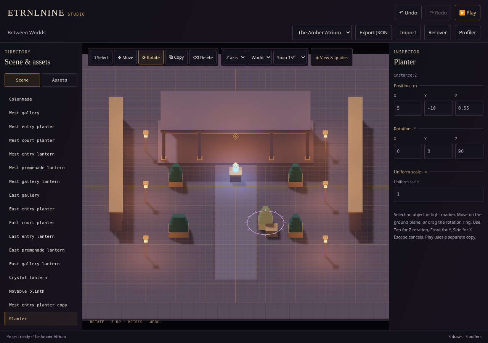
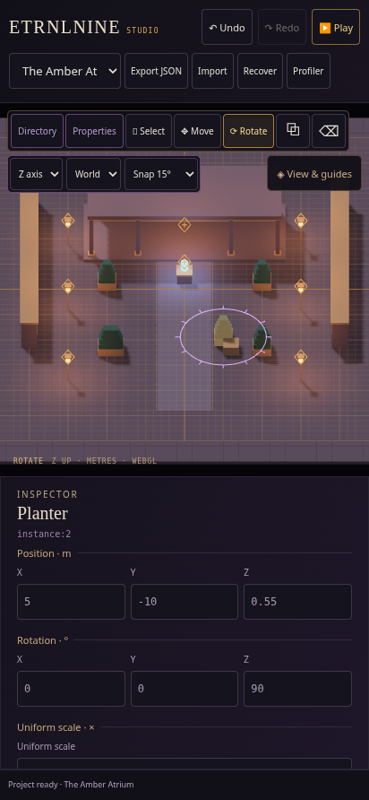

# Studio — authoring tools and DFAB-inspired workspace

Recorded 2026-10-16. This milestone adds the shared authoring tools needed before constructing the representative Freelancer street block. It does not yet add that street scene or the new articulated humanoid.

[Download Studio HTML](../../../dist/ETRNLNINE-Studio.html) · [Game-only HTML](../../../dist/ETRNLNINE-Atrium.html) · [Editing guide](../../../examples/atrium/DOCUMENTS.md) · [Ownership and limits](../../decisions/0008-studio-authoring-tools.md).

## Try it

Open Assets, choose a reusable assembly, and tap the construction plane to place it. Copy/Delete use shared undo/redo. Rotate supplies X/Y/Z, World/Local space and configurable angle snapping. View & guides toggles the construction grid and selectable light markers independently of snapping and lighting. Markers open the same contextual light properties and Move tool.

The charcoal, warm-gold and violet interface draws on the owner's DFAB suite. Scene and Assets share the left panel; the phone property sheet preserves a visible viewport. Native WebGL draws the guides. View preferences stay out of project JSON. Game-only builds exclude the guide toy and Studio application; Play releases guide resources.

## Screenshots

These are captures of the built offline application after touch placement and snapped rotation, rather than a UI mockup.

## Verification

- `npm test`: **56 passing tests**. New coverage includes world/local quaternion rotation, wrap/snap, nested asset bounds, topology identity/picking/collider cleanup and authored-ID allocation through undo. [Individual results](node-tests.txt).
- `npm run build`: separate game/Studio artifacts, with a second build producing identical bytes. [SHA-256 identities and sizes](build.json).
- `npm run test:browser`: existing rendering/input/lifecycle checks passed, including repeated scene replacement, flitting, AO/shadow behavior, context restoration and complete disposal. [Runtime results](runtime-results.json).
- `npm run test:studio`: existing touch move/cancel, numeric/history, import/export/recovery, joystick walking and four Play/Stop cycles passed. [Studio results](studio-results.json).
- `npm run test:studio-tools`: actual emulated touch selects and moves a light marker, places an asset on its true bottom, duplicates/deletes/undoes, performs snapped ring rotation and cancels a second gesture. Two more Play/Stop cycles preserve authored data and restore one edit world. Canvas2D is guarded against and the offline artifact makes zero runtime requests. The line-resource fixture restores a live layer after context loss, releases its shared shader on final-layer disposal and returns all renderer buffers/programs/VAOs to zero on engine disposal. [Authoring results](authoring-results.json).

Browser suites were run sequentially in Chromium 154 with SwiftShader. Software rendering needed a longer startup timeout than the initial 30-second harness allowance. These checks establish behavior and cleanup; **physical-phone frame rate, battery cost and driver compatibility remain unmeasured**. Browser checks are local verification; GitHub Actions runs source tests/build and uploads the offline HTML files.

## Next content stage

Use this workflow for Enni Cole's exterior, pavement, streetlights, planters and player, then approach → interact → enter → return. When the new procedural humanoid is tackled, review front, side, three-quarter and gameplay-camera solid silhouettes before surfacing, including backpack readability while walking and turning.

Source-part editing, reparenting, perspective/free-flight cameras, general dependency streaming and full 3D contact physics remain future work. The current diagnostic box actor is not the finished procedural humanoid.
