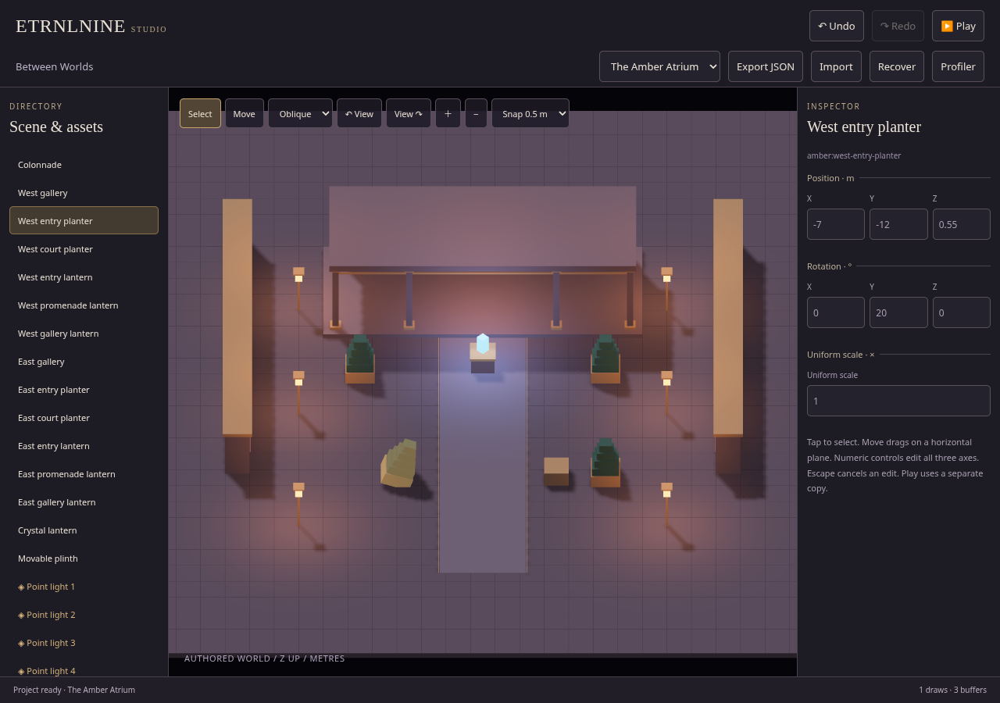
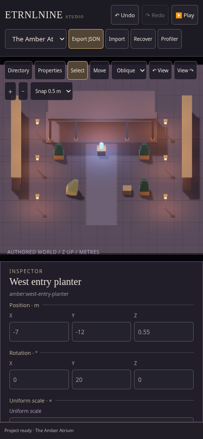

# ETRNLNINE Studio — first authoring workspace

Recorded 2026-10-16. The Atrium is now editable source data with a separate offline Studio application. This is the first shared authoring path, not a claim that all planned 3D simulation or specialist editors are finished.

[Download Studio HTML](../../../dist/ETRNLNINE-Studio.html) · [Game-only HTML](../../../dist/ETRNLNINE-Atrium.html) · [Editing/schema guide](../../../examples/atrium/DOCUMENTS.md) · [Architecture and limits](../../decisions/0007-studio-first-workspace.md).

Download an HTML file and open it in a WebGL2 browser. Both files include their project data and need no sibling files or CDN. A local source server can instead open `editor/` or `examples/atrium/`.

## First workflow

The shared workspace contains the scene hierarchy, asset inventory, WebGL viewport, contextual transform/light inspector, selection/move tools and project controls. Select the west entry planter, move it numerically or with a snapped touch drag, edit a point light, undo/redo, export/import, recover a local edit and Play the result with the existing touch joystick. Stop restores authored data and the editor camera.

Matching planters and lamps share source assets while owning independent placement/runtime state. IDs have readable persistent names. A selected assembly receives a transient WebGL material highlight; the property sheet resizes the phone viewport instead of covering it. Full quaternion orientation is available through numeric XYZ degree controls. Top/front/side/oblique views, horizontal orbit and zoom support inspection.

## Screenshots

**Desktop · one contextual workspace**

**Phone · a resized viewport and shared property sheet**

The selected west entry planter was moved, rotated about Y, saved/reloaded and played without changing its authored identity. These are captures of the actual WebGL workspace.

## Verification

All checks completed successfully:

- `npm test`: **51 passing tests**, including project references/versions/budgets, inert JSON embedding, transactional cancellation/history, transformed collision/picking and attachment transfer.
- `npm run build`: separate game and Studio HTML outputs. A repeated build produced identical bytes. [Build identities and sizes](build.json).
- `npm run test:browser`: existing rendering/input/lifecycle suite passed with Canvas2D guarded against. It exercised 12 scene replacements, ten flits with stable actor identity and state restoration, AO/shadow pixels and caches, context loss/restoration, input/pause, and complete disposal. [Runtime results](runtime-results.json).
- `npm run test:studio`: phone-sized numeric editing, blank-number rejection, transform/light undo/redo, export/reload, invalid-import isolation, actual captured touch move/cancel with snapping, best-effort recovery across navigation, full rotation, joystick walking and four Play/Stop cycles passed. The exported authored project remained unchanged by gameplay. Final editing state returned to one world and three renderer buffers; artifact execution made zero runtime requests and reported no browser errors. [Studio results](studio-results.json).

[Node test output](node-tests.txt) records the individual checks. Static close-up comparison captures submit one frame per quality setting; runtime scheduling and both-world readiness are exercised separately. This avoids queuing continuous software-GPU work during screenshots without changing production scheduling.

The GitHub workflow runs source tests and packaging and uploads both HTML files. Browser checks are local development checks here, not falsely represented as CI jobs.

## Practical limits

Collision remains planar, with transformed conservative XY footprint bounds. The engine does not yet provide full 3D contact physics, perspective/free-flight cameras, arbitrary mesh/skinning assets or the articulated humanoid workshop. The asset browser is an inventory; part geometry and source material definitions are edited through JSON/reopen at this stage. Dedicated axis gizmos, duplicate/reparent commands and specialized registered workspaces remain future work.

The first schema is one portable package containing asset/scene tables, not a general multi-file dependency loader. Runtime reconstruction yields one bounded assembly at a time through Lobby; editor candidate construction is synchronous under explicit scene/part limits. History is capped at 64 commands and 2 MiB of snapshot strings; the project limit is 512 KiB of compact JSON.

Browser recovery is best-effort. Keep exported backups. Editing JSON directly on GitHub produces a fresh Actions artifact for that commit; CI does not rewrite checked-in `dist/` files or deploy a site.

These screenshots and tests use headless Chromium 154 with SwiftShader and an emulated 412 × 892 touch viewport. They establish behavior and cleanup, **not physical-phone frame rate, battery cost or driver compatibility**. Actual-device performance remains unmeasured.
