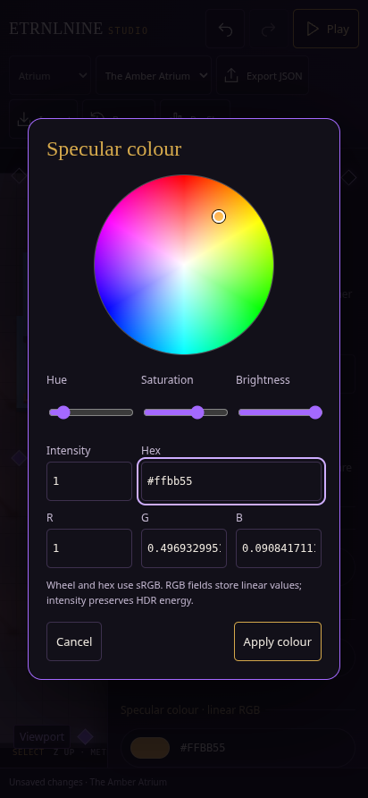

# Surface studio · polish and colour

[Surface and colour contract](../../decisions/0018-surface-response-and-colour.md) · [Offline Studio](../../../dist/ETRNLNINE-Studio.html).

Materials now expose specular colour, sharpness and reflectivity. Colour pills open the
shared touch/keyboard wheel, brightness, HDR intensity, sRGB hex and precise linear RGB.
Apply creates one history command; Cancel/Escape restores the opening value. Older
projects keep their diffuse appearance until reflectivity is raised.

## First tuning pass

| Surface | Reflectivity | Sharpness | Specular tint |
| --- | --- | --- | --- |
| Existing matte appearance | 0 | any | any |
| Polished stone | 0.04–0.08 | 0.7–0.85 | white |
| Artistic champagne finish | 0.45–0.65 | 0.75–0.9 | warm gold |

Raise reflectivity to see a light highlight, then use sharpness to shape it. Exposure
and bloom still live in Viewport → Appearance. These are starting points, not new
presets applied to authored content.

## Previews

[Material inspector](material-inspector.png).

## Verification

**All eight acceptance commands pass:** [suite exits and durations](regressions.json).

[90 unit tests](node-tests.txt) · [reproducible offline build hashes](builds.json).

[Camera navigation](camera.json) · [Freelancer integration](freelancer.json) · [Authoring tools](tools.json) · [Studio lifecycle/input/files](studio.json) · [Runtime/renderer](runtime.json) · [material authoring](materials.json) · [bloom rendering](bloom.json) · [Studio/game bloom controls](bloom-controls.json).

[Focused control and pixel report](controls-and-pixels.json). The recorded reports cover direct specular pixels, broad/polished lobes, tint, both
camera lenses, sun/point contributions, HDR composition, stable uploads and disposal.
Pixel `lit` counts measure the area above half of each image’s peak, comparing lobe widths. The actual offline Studio exercise covers exact linear values, HDR, one-step undo,
unchanged Apply, Cancel/Escape, pointer cancellation, keyboard/hex editing, invalid
fields, repeated modal cleanup and zero runtime requests.

This uses software Chromium WebGL and emulated touch, not physical-phone performance
measurements. Reflectivity controls direct-light surface response; mirror/scene
reflections, transparency/refraction and environment probes remain future work.
