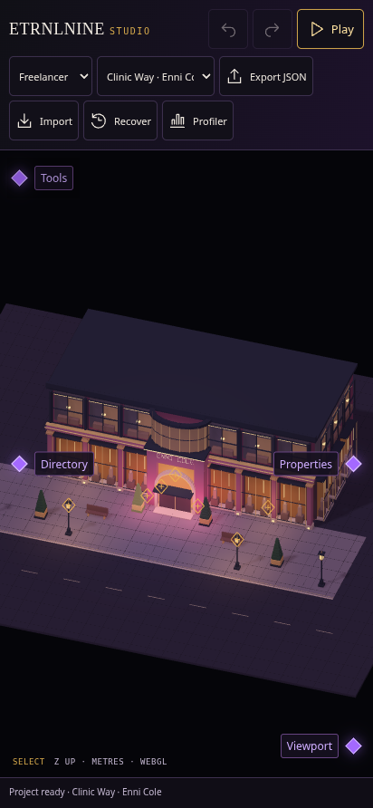

# Studio · a clearer viewport

[Controls and ownership](../../decisions/0017-studio-tool-surface.md) · [Offline Studio](../../../dist/ETRNLNINE-Studio.html).

Use the **Tools** diamond at the upper-left of the viewport to fold or reopen the complete toolbar. The active tool remains available: choose Pan, fold Tools, and keep navigating. Opening other panels does not change your Tools choice. Play restores the prior layout on Stop.

## Previews

[Phone with Tools open](phone-open.png) · [Desktop with Tools folded](desktop-collapsed.png).

## Verification

- **Shell, authoring tools and camera acceptance pass:** [suite results](regressions.json) · [shell](shell.json) · [tools](tools.json) · [camera](camera.json).
- **87 unit tests pass:** [output](node-tests.txt).
- **Offline builds reproduce byte-for-byte:** [SHA-256 hashes](builds.json).
- **Focused control acceptance passes:** [touch/keyboard, focus across nested docks, modes, independent layouts, clean history and both Play restoration states](controls.json).

The native WebGL scene keeps its canvas dimensions when tools fold. Controls use the existing accessible PanelDock and SVG family, with no extra frame loop, authored-data changes or network dependencies. Phone checks use emulated touch/software WebGL rather than a physical-device performance measurement.
