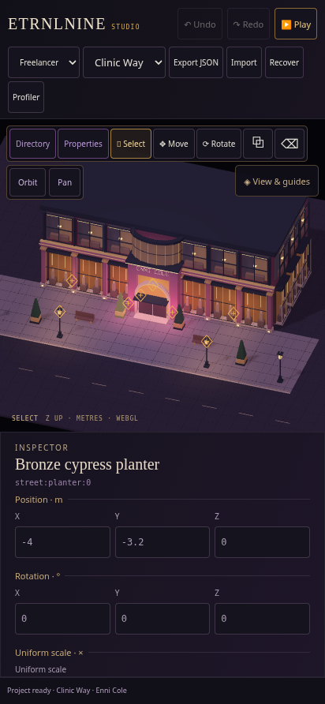
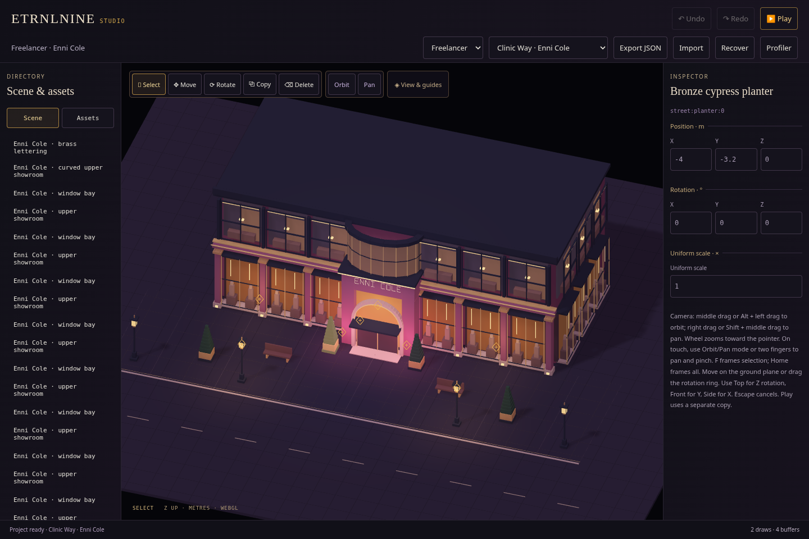

# Studio · viewport navigation

Recorded 2026-10-16. The shared workspace now supports mouse and touch orbit, view-plane pan, pointer-anchored zoom and selection/scene framing. [Download Studio](../../../dist/ETRNLNINE-Studio.html) · [Controls, architecture and light parameters](../../decisions/0010-viewport-navigation.md).

Use middle drag or Alt + left drag to orbit; right drag or Shift + middle drag to pan. On a phone, choose Orbit/Pan for one finger or use two fingers from any tool to pan and pinch. Wheel zoom follows the pointer. F frames selection, Home frames authored geometry, and Reset view restores the scene's initial view. Escape cancels a camera gesture. The camera remains orthographic.

## Verification

- `npm test`: **66 passing tests**. New tests check pointer anchoring, pan direction in oblique/front/side/top views, framing transformed geometry, zoom/pole limits and pose restoration, constructor failure cleanup and repeated disposal. [Node output](node-tests.txt).
- `npm run build`: three offline targets with reproducible bytes. Both standalone games are byte-identical to the preceding street milestone; navigation is imported only by Studio. [Build identities](build.json).
- `npm run test:camera`: actual mouse orbit/pan/wheel, Escape cancellation, F/Home framing, two-finger pinch/pan with placement armed, promotion from an already-previewed object Move into two-finger navigation, explicit touch orbit, touch cancellation and edit camera restoration after Play/Stop. Exported JSON remains unchanged, with no extra undo command from navigation or a cancelled object move. Canvas2D is guarded against; the offline artifact makes zero runtime requests and reports no browser errors. [Results](camera-results.json).
- `npm run test:studio` and `npm run test:studio-tools`: existing import/recovery/history, touch transforms/cancellation, rotation dial, light markers, repeated Play/Stop and guide context-restoration/disposal checks. [Studio results](studio-results.json) · [Authoring results](tools-results.json).

Browser suites run sequentially in Chromium 154 with SwiftShader and emulated touch. They establish interaction and cleanup behavior, not physical-phone frame rate, battery cost or driver compatibility. The runtime renderer was unchanged; the standalone game artifacts retain their prior bytes. GitHub Actions runs source tests and packaging, not these local browser suites.

Camera movement is view state, separate from game JSON/history. It adds no GL objects or host animation loop. Perspective/free-flight cameras and camera animation remain future work. Light objects still expose XYZ, RGB irradiance and radius; the linked decision lists their exact ranges and distinguishes engine shadow options from inspector controls.
