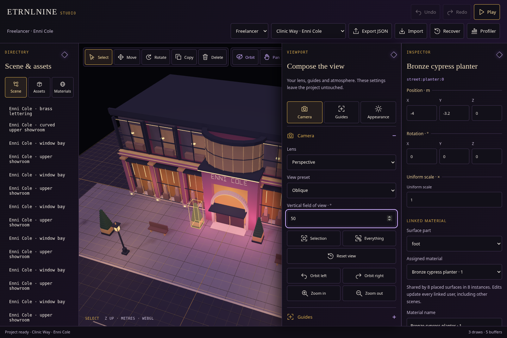
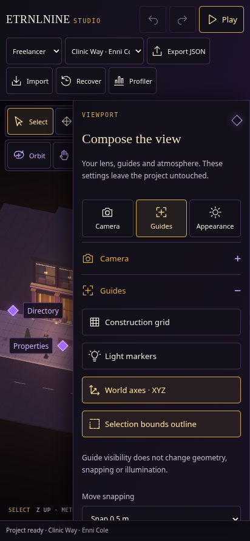
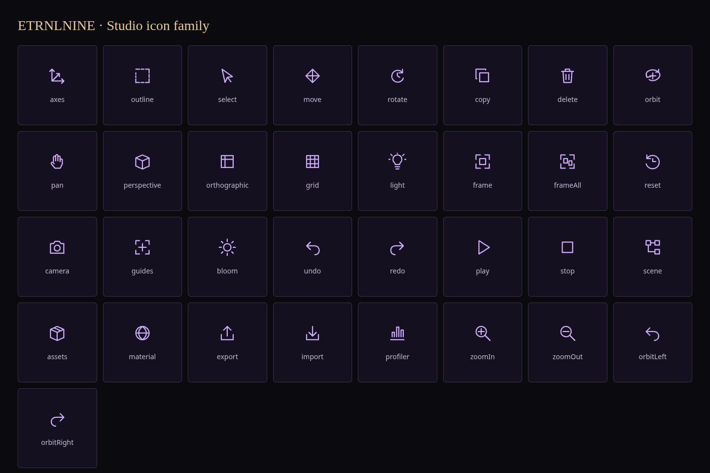

# Studio · Compose the view

[Decisions and source ownership](../../decisions/0016-viewport-panel-and-iconography.md) · [Offline Studio](../../../dist/ETRNLNINE-Studio.html).

Use the **Viewport** diamond for Camera, Guides and Appearance. Section shortcuts open the desired controls directly. The small viewport strip provides lens, grid, light-marker and frame-selection shortcuts; the same actions and settings power their detailed equivalents.

Guides include independent world axes and a selection-bounds outline, using the existing native WebGL line layers. Bounds are cached across camera movement, and hidden guides release unused layers.

The original SVG family replaces text-symbol art throughout the toolbars. Native names, focus, touch targets and real labels remain. On phones only one of Directory, Properties and Viewport opens at a time, over the unchanged full-size scene. Play temporarily hides them and restores the workspace on Stop.

## Previews

Scene previews use the existing Luxe bloom recipe.

[Phone clear view](phone-clear.png) · [Phone camera](phone-camera.png) · [Phone appearance](phone-appearance.png) · [Desktop appearance](desktop-appearance.png).

The exact 33-vector catalog used by Studio:

## Verification

- **Full engine browser regression passes:** [rendering, input, worlds, profiler, context restoration and resource cleanup](runtime.json).
- **87 Node tests pass:** [test output](node-tests.txt).
- **All offline builds reproduce byte-for-byte:** [SHA-256 hashes](builds.json).
- **Studio editing acceptance passes:** [properties/history, file recovery, walk and four Play/Stop cycles](studio.json).
- **Materials pass:** [emissive pixels, linked edits, private overrides, creation and assignment](materials.json).
- **Existing regressions pass:** [six serial suites and durations](regressions.json).
- **Authoring tools pass:** [placement, light movement, duplication/deletion, rotation and line-resource restoration](tools.json).
- **Camera controls pass:** [mouse/touch navigation and gesture/Play restoration](camera.json).
- **Shared appearance controls pass:** [Studio and Freelancer](appearance.json).
- **Existing shell acceptance passes:** [responsive state, accessibility and document isolation](shell.json).
- **Viewport/icon acceptance passes:** [catalog, lifecycle, shared state, camera validation, three-panel touch/keyboard, unchanged documents and Play restoration](viewport.json).

The delivered HTML embeds local CSS, modules and authored JSON; SVG art makes no network requests. Rendering remains native WebGL2, with no Canvas2D or additional frame loop. View settings remain outside project history and files. Browser checks run with software WebGL and emulated touch; they do not establish physical-device performance.
