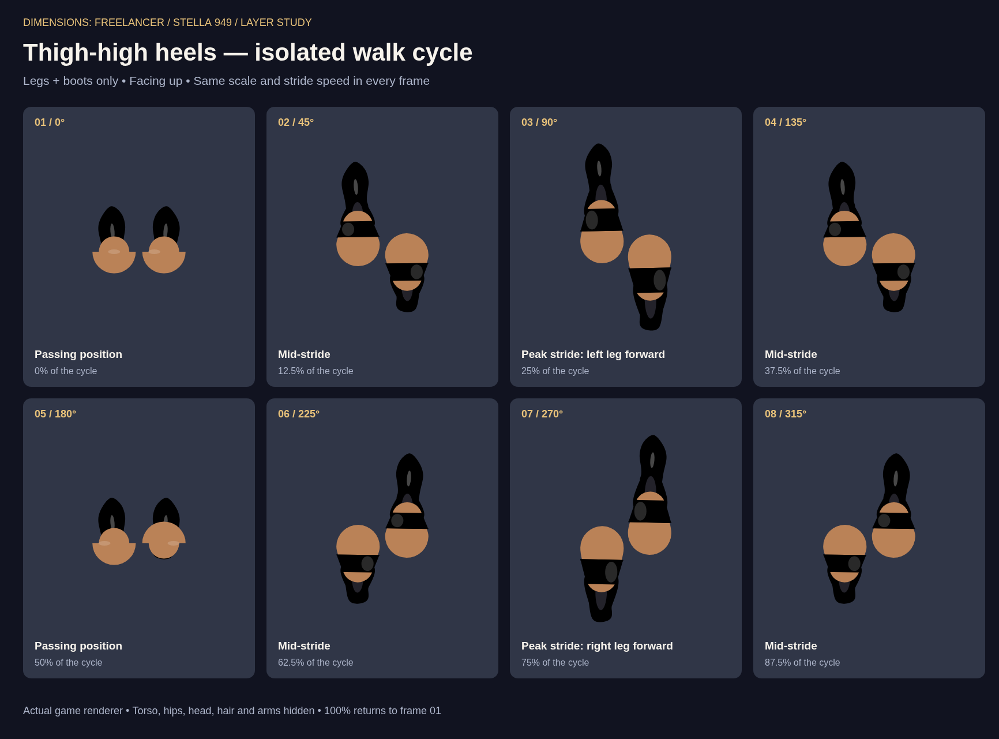

# Thigh-high heels: isolated walk cycle

This reference shows Stella's legs and thigh-high heels at eight stages of the walking animation, with hips, torso, arms, head and hair hidden.

## Render settings

- Source snapshot: `e9adf6f6f67ad061040ccbeaff7dcd3699524f3a`.
- Renderer: the game's `drawProceduralHumanoid`, using Stella's female body and natural skin tone.
- Shoes: `COSMETICS_REGISTRY.leg_thigh_heels.data.shoes`.
- Direction: facing and moving up.
- Gait speed: 3, matching the earlier customization catalog.
- Walk phases: 0 through 7π/4, in π/4 increments. Frames 3 and 7 show peak stride.
- Scale: 8× in every frame. Shadows and idle poses are disabled.
- Layer isolation: the preview stops `_drawHumanoidBody` immediately before its “Hips & Skirt” pass, after the original feet, calves, thighs and boot overlays have drawn.

The layer switch was applied only inside the preview browser. The PNG records the existing rendering, including any visible seams or overlaps, for visibility review.

## Validation

Rendered in Chromium with no browser errors and visually checked for all eight frames and readable labels. This change adds documentation only.
