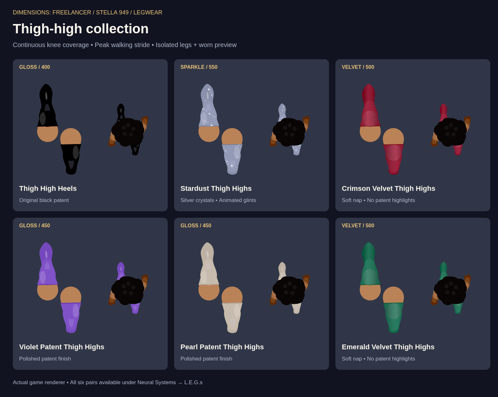
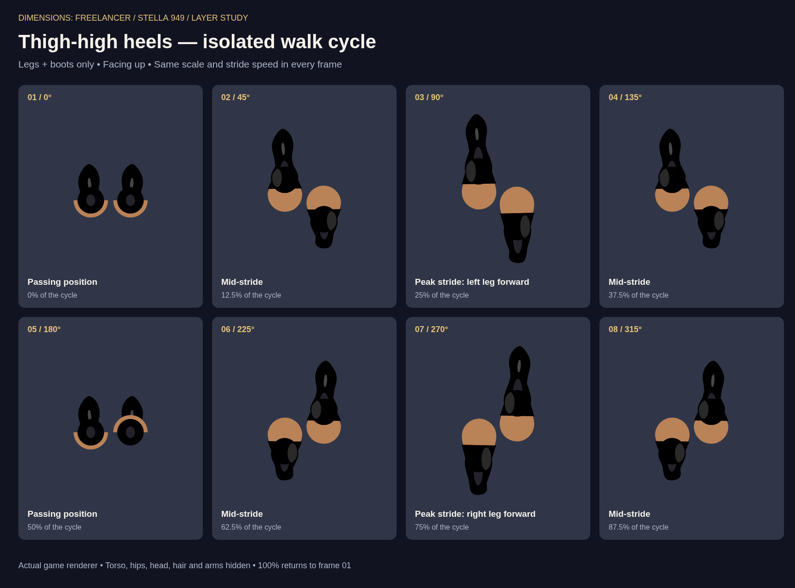

# Thigh-high coverage and finishes

The knee previously showed skin between the upper boot and calf. Bare thighs painted over the calf layer, and a fixed projected clipping length missed the rounded knee at short strides. The complete boot now paints after the bare legs; a covered knee joint and a radius-based thigh span maintain coverage even in the passing pose. Gloss is clipped to the fabric span.

| Item | Finish | Price |
| --- | --- | ---: |
| Thigh High Heels | Original black patent | 400 |
| Stardust Thigh Highs | Silver crystals with slow animated glints | 550 |
| Crimson Velvet Thigh Highs | Red velvet with soft nap | 500 |
| Violet Patent Thigh Highs | Glossy violet | 450 |
| Pearl Patent Thigh Highs | Glossy ivory | 450 |
| Emerald Velvet Thigh Highs | Green velvet with soft nap | 500 |

Buy the new items at Neural Systems in **L.E.G.s**, then equip them in **NEU.ME**. Equipping a pair replaces previous boot footwear while retaining thigh bands. Original black-boot saves retain their existing item ID and appearance settings.

## Walk-cycle reference

Both sheets use the actual game renderer, Stella's natural skin, gait speed 3, and an upward facing/travel direction. The walk-cycle sheet advances in π/4 increments; frames 3 and 7 are peak strides. Only the preview browser hides upper-body layers. The variants sheet shows isolated legs alongside a worn preview with shorts and a black sports bra. Isolated and worn views have different enlargement factors, shared across all six cards.

## Checks

- `node tools/build.mjs --check`
- `node tools/test-game-regressions.cjs`: includes purchasing, footwear replacement, preserving thigh bands, old black-boot saves, and finish persistence after save/load.
- `node tools/test-legwear-visual.cjs` (requires Playwright and Chromium): 2,304 real-browser render comparisons across six variants, 32 phases, four speeds and three detail levels. Changing the underlying skin color must not change pixels inside either knee. Also checks that sparkle changes with time while velvet stays steady.
- The browser knee test reproduces the failure against the pre-fix build. Preview images were inspected in addition to the automated checks.
