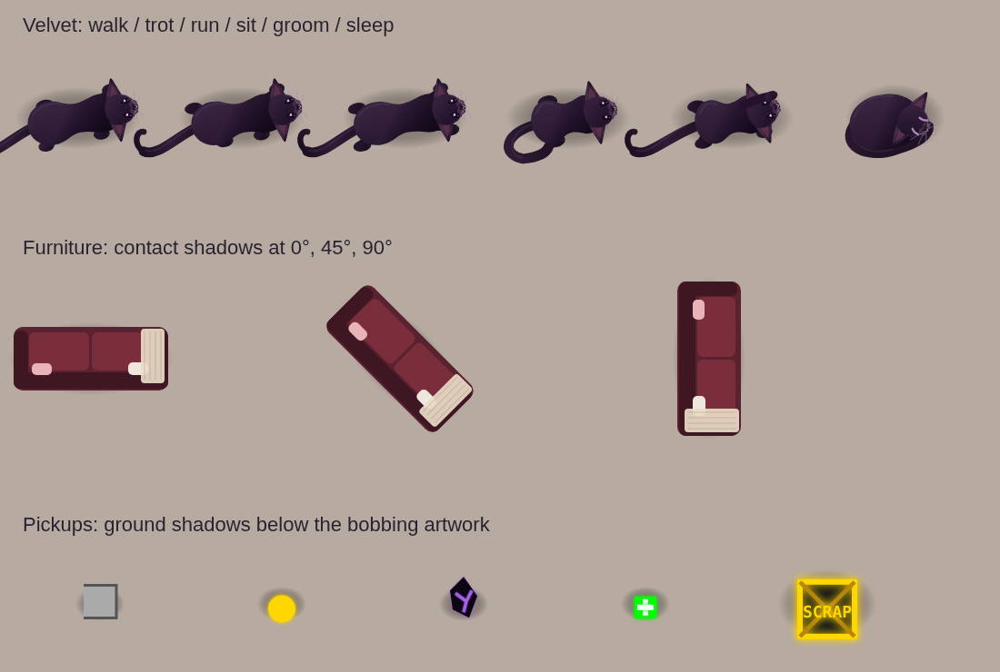
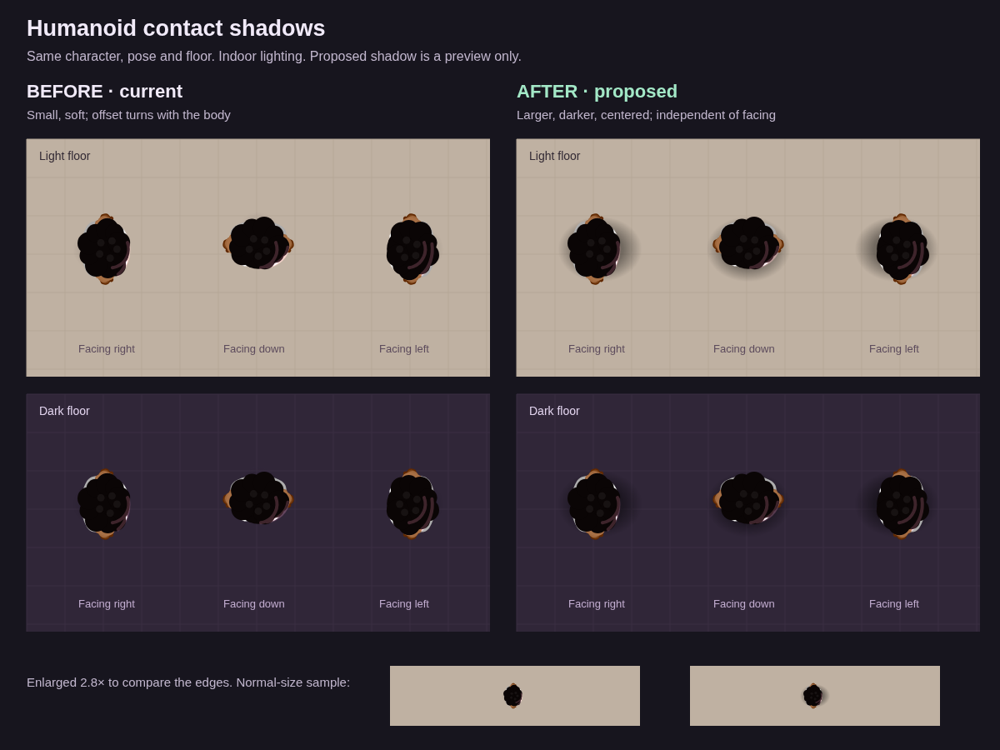

# Velvet movement and ground contact

Velvet uses the existing `NavGrid` and cached waypoints, including live furniture geometry. She accelerates, slows for corners and arrival, and turns before stepping into a tight passage. A stable position behind and beside the player and separate start/stop distances give her time to settle. Unreachable routes wait without teleporting through walls. Existing map-change placement and vehicle boarding remain responsible for relocating the companion.

The four paws now use walk, diagonal trot and paired running rhythms driven by distance actually travelled. Body motion, resting transitions, grooming, looking, blinking and sleep breathing use simulation phases. Discoverable Velvet also animates while waiting for adoption. Her cosmetic random choices use a private stream so they do not change traffic or loot outcomes.

Props draw one soft, centered contact shadow outside their cached or live artwork. The contact footprint follows the item's base with no displaced offset that swings around during rotation. Velvet's shadow is independent of facing; pickup shadows stay at their ground positions while the artwork bobs. Former floor silhouettes were removed from furniture art and gravestone sprites; surface shading and luminous effects remain.

Validation: generated HTML build consistency, navigation and ground-shadow regression checks, the complete game regression suite, and a Chromium canvas preview. The enlarged still preview shows poses; movement feel and frame rate on target devices still need playtesting.

## Approved humanoid contact shadow

Procedural humanoids and cached crowd characters now use the approved 36 × 28 px centred black contact ellipse with a stronger soft falloff. Facing is removed from the ground pass, so the ellipse and sun anchor stay fixed as the body turns. Existing sun and lamp casts remain, and cached crowds continue to draw shadows live. The normal detail/driver/reflection exclusions remain in effect.

