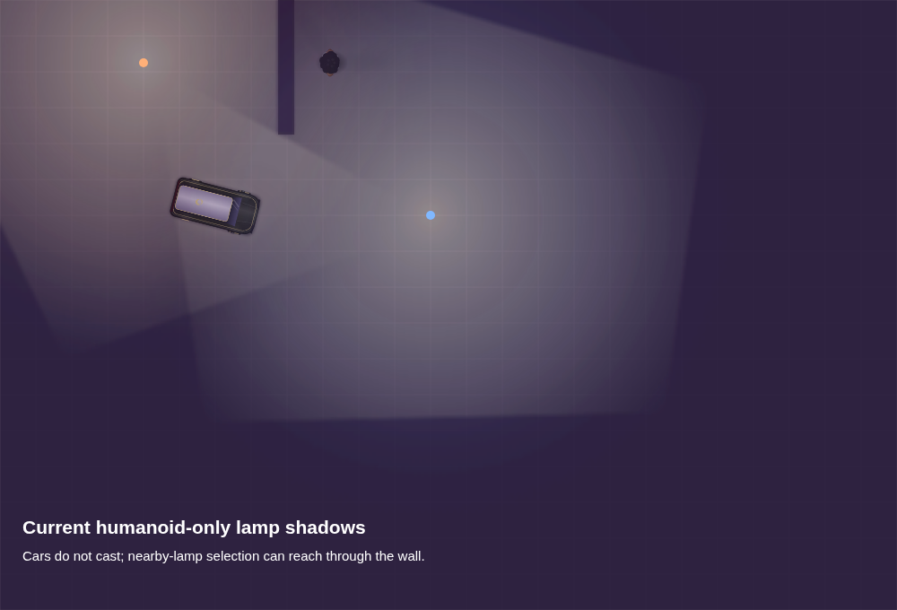
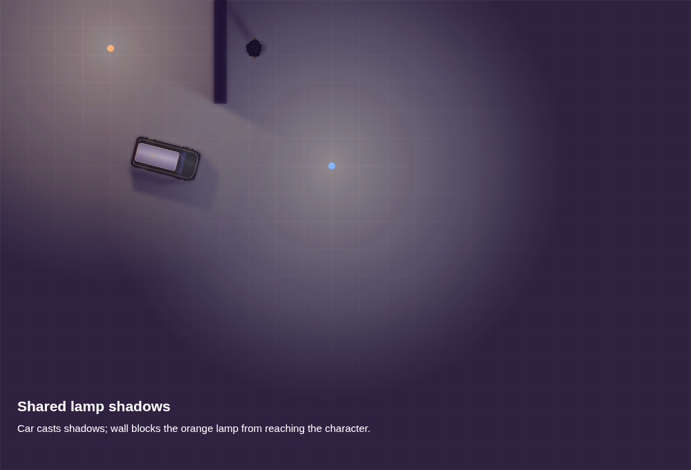
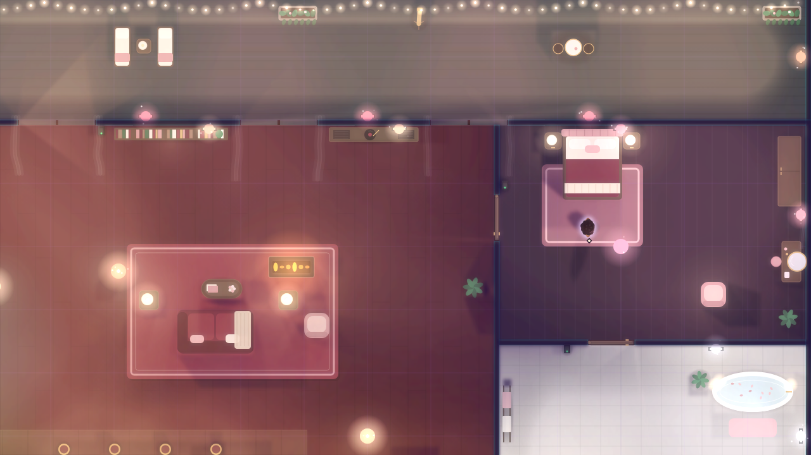
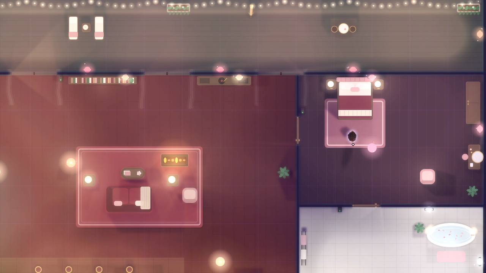
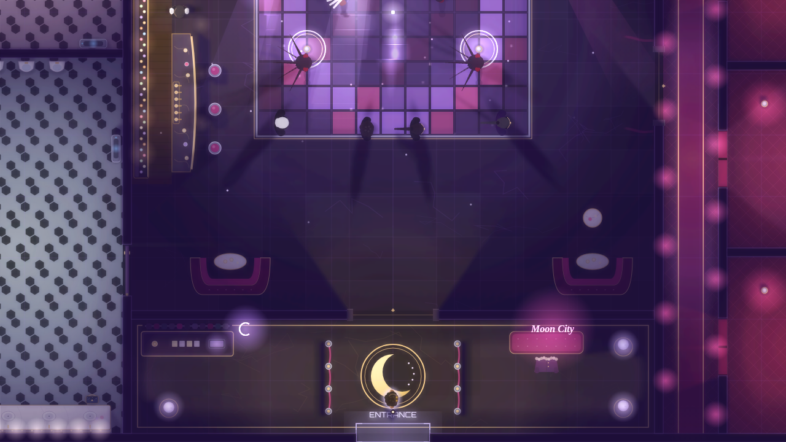
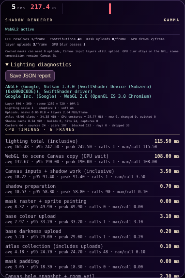
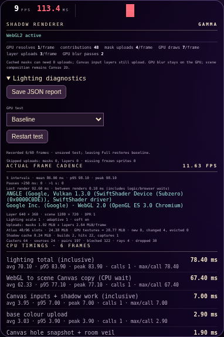

# Shared dynamic light shadows — trial

Lamp occlusion now belongs to each lamp's own contribution to the lighting layer. A source's shadow mask is applied to both its darkness-cutting and colour passes. Other lamps and transient lights can illuminate that shadow instead of being darkened by a final humanoid-specific overlay. Ground contact and sun shadows are unchanged.

Humanoids, cars (including traffic and bumper cars), collidable furniture and Velvet register local caster shapes with `DynamicShadows.note(entity, shape)`. Supported shapes are circles, oriented boxes, local polygons (3–32 points), and optional captured humanoid silhouettes on High. Shape fields include `radius` or `width`/`depth`, centre offsets `dx`/`dy`, `elevation` and `opacity`. Polygon edits, movement, rotation and appearance changes invalidate relevant cached masks. A lamp may supply `elevation`; otherwise the stylized projection uses a common default height.

Wall/building visibility uses the existing spatial index. Rotated caster footprints occupy every intersected grid cell. Door leaves cast at their actual hinged or sliding pose: opaque leaves block light, sliding glass transmits it (default opacity 0.35), retracted leaves and arches cast nothing. Door materials can set `shadowOpacity` and `shadowElevation`. Each caster receives its own source light; its unprojected body is removed from its cast before masks are combined. Casts from other entities can still overlap it.

The shared engine owns visibility, projection, silhouette captures, bounded caches and map lifecycle. Renderers no longer select the nearest two lamps or restore darkness after all sources have been combined. The integration covers standard lamps, baked building-interior lights, headlights and their spill, soft decor/area lights, neon, fireballs/trails, projectiles, muzzle flashes, medbay/vending glows and vehicle underglow. Adapters preserve each source's authored falloff, colour, flicker and static clipping. Headlights use a cone filter and tight rectangular buffers; fire and beams share identical hole/colour bitmaps. Interior lights retain their baked wall visibility. Source owners are excluded from their own casts. Sun/daylight/window projections and special club beams retain their separate paths.

| Setting | Total shadowed sources | Standard lamps | Per other family | Casters per source | Mask cap |
|---|---:|---:|---:|---:|---:|
| Off | 0 | 0 | 0 | 0 | — |
| Low | 24 | 8 | 4 | 12 | 128 px |
| High | 48 | 16 | 8 | 24 | 256 px |
| Ultra | 80 | 32 | 12 | 32 | 256 px |
| Gamma (experimental) | 48 | 16 | 8 | 24 | 256 px |
| Beta (experimental) | 128 | 48 | 20 | 48 | 512 px |

High can capture humanoid silhouettes; other qualities use projected hulls. Ordinary elevated lights use nominal 90 px / 120 px casts on Low / High. Door leaves, Ultra casts and sources below a caster's height can block toward the source's light edge.
Up to 256 visible casters register per frame, with a 24 MiB cap on lamp-mask caches. Budget exhaustion falls back to the lamp's normal static visibility without applying a stale mask. Stationary pairs reuse visibility and raster masks; moving entities and light sources re-plan only affected contributions. High limits captures to 16 per frame, normally refreshing moving silhouettes every 100 ms and stationary ones every second; facing and appearance changes invalidate them immediately. Cached crowd bodies use geometric fallback instead of forcing a live body capture.

`DynamicShadows.stats` reports source/door/caster/pair counts, blocked pairs, ray queries, mask builds/hits, captures and budget drops. Visibility is evaluated in the same render frame; there is no previous-frame caster list.

## Preview

The wall separates the orange lamp from the character. Cars now cast from the same lamp sources as humanoids.

| Before | Trial |
|---|---|
|  |  |

## Validation and performance

The dependency-free game regressions cover walls, doors, source/caster movement, rotated boxes, polygon edits, all quality levels, resource budgets, removal, cache reuse and map resets. `tools/test-dynamic-shadows-browser.cjs` checks real pixels for overlapping-light conservation, self-shadow exclusion, rotating doors, glass transmission, sliding retraction and headlight cone filtering (requires Playwright and Chromium).

Before adding doors and the additional source families, one warmed headless Chromium apartment sample (50 measured frames after 15 warmups) gave these full-scene timings:

| Renderer | Median | 90th percentile |
|---|---:|---:|
| Main before this trial | 21.0 ms | 23.3 ms |
| Shared pipeline, humanoid casters only | 19.4 ms | 20.9 ms |
| Shared pipeline, expanded caster coverage | 22.6 ms | 25.5 ms |

The expanded scene registered 56 casters and 59 source/caster pairs, reused eight masks, performed zero visibility queries/rebuilds in the sampled stationary frame, and used 1 MiB of mask cache. These are single-machine exploratory timings, not a claim of improved frame rate across devices or moving scenes. The shared pipeline reduced cost with comparable humanoid coverage in this sample; casting from more entities increased total work. Low's budgets keep that expansion bounded. Source test data is in `browser-checks.json`.

The extension passes 96 dependency-free regressions (1,373 assertions). Real browser results are in `extended-browser-checks.json`: closed door shadow alpha 255, swung clear 164, glass 195 and fully retracted 164. A real headlight adapter pairs an in-cone caster and skips an off-axis one, using a 30,000-byte buffer. These fixtures verify rendering behaviour; the earlier timing sample does not benchmark this extension.

## Experimental Beta option

Select **Light Shadows → Beta** in settings. Beta is opt-in and saved per device; Low remains the default. It doubles Ultra's maximum mask resolution and sample density, raises source/caster budgets, and retains full-range geometric casts and the 24 MiB cache ceiling. High remains the captured-humanoid-silhouette mode. Beta uses hulls, as Ultra does. This is a higher-cost quality experiment, not a new 3D lighting model.

The renderer draws scene artwork once and accumulates per-source contributions into a Canvas 2D light layer, using darkness removal and additive colour. Each source has its own shadow mask and cached visibility. It is 2D light compositing, neither a full scene redraw per lamp nor a deferred G-buffer renderer.

## Experimental Gamma: batched GPU lighting and blur

Select **Light Shadows → GAMMA (EXPERIMENTAL)**. Gamma retains High's source/caster budgets, 120 px nominal cast reach, mask density/resolution and humanoid silhouette capture policy. It changes compositing, not shadow shape quality.

The original tiled fullscreen shader has been replaced by two instanced sprite batches. Hardware blending removes darkness with `ZERO / ONE_MINUS_SRC_ALPHA`, then applies the room veil with source-over, and adds colour with `ONE / ONE`. Only the rectangular footprint of each light is shaded; there is no per-pixel tile-list loop or CPU tile-list construction/upload. Normal scenes use five GPU draws, rather than one much heavier draw. A missing room veil saves a fullscreen draw and its upload.

Soft lighting uses two separable three-tap GPU blur passes at the existing half resolution. The game draws the WebGL output directly into the scene canvas, using the same crop/upscale as High. This removes the intermediate copy back into the Canvas light layer and six Canvas blur copies. The standalone `finish(ctx)` API still supports a Canvas result for pixel tests and callers that need it. The WebGL drawing buffer is not preserved across presentation; the game consumes it synchronously in the same draw call.

High's cached shadowed sprites remain in a padded atlas. It now actually holds up to 96 distinct sprites (the earlier square allocation stopped at 64), with unused-slot/LRU eviction that protects this frame's queued draws. Stationary sprites stay resident and changing sprites alone are refreshed. The usual 24 MiB CPU cache budget applies. The atlas adds about 24.4 MiB on typical devices; soft mode also allocates two light-sized RGBA8 targets. Quality/map switches release source references.

Static/unshadowed/special lighting inputs remain Canvas 2D. Two full light-layer textures still upload every frame, or three when a room veil is present. Shadow preparation and final scene composition remain separate work. This is a hybrid renderer, not GPU-generated shadow maps or a depth/normal/material G-buffer. Gamma uses WebGL2 even on known software GPUs, with no performance-based backend substitution. WebGL2 absence, context loss, upload failure or interrupted GPU execution retain the High path and replay queued contributions.

### Validation

`tools/test-dynamic-shadows-browser.cjs` checks real Chromium pixels for independent lights, room veil ordering, direct GPU output, GPU blur including edge pixels, warm atlas reuse with 90 distinct sprites, single-sprite invalidation, resize, upload/resolve failures, and full apartment/nightclub scenes. The headlight fixture now restores the game's original light context; previously the scene checks rendered into that fixture's detached canvas.

Results are in `gamma-batched-browser-checks.json`. Mean full-scene channel differences versus High are below 0.6/255 with sharp lighting and below 1.6/255 with soft lighting. Small differences are expected from 8-bit blending/blur rounding and sprite edge rasterization. All 98 game regressions pass (1,379 assertions), and the offline build is rebuilt and checked.

| High soft lighting | Gamma GPU soft lighting |
|---|---|
|  |  |
|  |  |

### Performance experiment

`node tools/benchmark-gamma.cjs [path-to-game.html]` compares High/Gamma in the apartment and nightclub at a 1280 × 720 viewport, with sharp/soft lighting and stationary/moving-player fixtures. Adaptive lighting is disabled. Each of three rounds uses 15 warmups and 30 samples; mode order alternates between rounds. Draw submission and completion are reported separately. Completion forces a one-pixel scene readback to avoid mistaking queued GPU commands for completed rendering; this introduces synchronization and changes Canvas behavior, so these values are not gameplay FPS predictions.

The workspace uses ANGLE/Vulkan SwiftShader, a software GPU. Original/new raw results and comparisons are recorded alongside this document. These recorded measurements explicitly forced WebGL before the software-GPU gate was removed. Gamma, the benchmark and developer pixel checks now use WebGL by default on all available renderers, without an override flag. Runs are exploratory, not a claim that Gamma beats High on hardware GPUs. The remaining Canvas input uploads and shadow preparation still need device profiling.

Median completed-frame milliseconds (median of three round medians):

| Scene | Lighting | Player | Original Gamma | Batched Gamma | Current High |
|---|---|---|---:|---:|---:|
| Apartment | Sharp | Stationary | 355.8 | 261.2 | 69.3 |
| Apartment | Sharp | Moving | 363.8 | 260.8 | 75.0 |
| Apartment | Soft | Stationary | 173.4 | 92.0 | 31.9 |
| Apartment | Soft | Moving | 186.8 | 96.3 | 36.7 |
| Nightclub | Sharp | Stationary | 381.7 | 193.5 | 53.3 |
| Nightclub | Sharp | Moving | 392.7 | 209.2 | 57.5 |
| Nightclub | Soft | Stationary | 125.8 | 87.3 | 33.6 |
| Nightclub | Soft | Moving | 81.7 | 83.1 | 37.8 |

Most cases reduce Gamma cost by 27–49%; the moving/soft nightclub case is effectively unchanged. High remains faster on this software GPU; Gamma now deliberately runs WebGL there for experimentation. High timings also vary between runs (especially the nightclub); geometry/setup variance and concurrent validation work make this an exploratory comparison. Raw data: `gamma-original-benchmark.json`, `gamma-batched-benchmark.json`, and `gamma-benchmark-comparison.json`.

### Detailed lighting profiler

Open **Settings → Developer → Profiler → Full**, reproduce the slow scene, then tap **Save JSON report** in **Lighting diagnostics**. Gamma continues to use WebGL on software GPUs; the profiler does not select a different renderer. Diagnostics run only in Full mode, and update approximately twice a second even at low frame rates. Compact/Off remove shadow timing wrappers, stop collecting samples and release pending timer queries.

The panel shows the WebGL renderer/vendor/version, actual lighting/scene dimensions, device pixel ratio, selected lighting/adaptive scales, per-frame upload bytes, atlas occupancy/new/changed/evicted sprites, estimated RGBA texture storage, and source/caster/pair/capture/cache counters. Unknown cache entries no longer poison the total with NaN; the approximate cache count identifies omitted entries.

CPU rows show the current frame, mean, 95th percentile, peak, call count and worst call across up to 60 frames. They separate registry work, shadow preparation and its pairing/visibility/raster stages, silhouette body capture/cache copying, atlas collection and its padding/upload stages, hole/veil snapshot, each of the three full Canvas layer uploads, surface/blur-target setup, resolve/blur command submission and final WebGL-to-scene Canvas copying. Timings include any synchronous browser/driver waits. Parent/child rows overlap and must not be summed. Samples reset when the map, shadow mode, soft-light setting, scene dimensions or selected lighting scale changes.

When `EXT_disjoint_timer_query_webgl2` is available, separate **GPU execution** rows show asynchronous resolve and blur timings with their original frame ID and sample age. Sampling runs every fourth render frame, with at most eight pending queries. Results are read only when available; disjoint/context-lost/expired results are discarded and queries are cleaned up. Unsupported devices explicitly report **GPU timer unavailable**. The profiler never calls `gl.finish` or performs a forced pixel readback.

The old **browser/GPU** remainder is now labelled **unattributed/wait**. It remains an estimate from frame cadence minus the game's measured work, and includes scheduling, browser work and unmeasured waits. It is not a GPU measurement.

The JSON report contains device/settings information, the latest frame and up to 60 raw frames, CPU summaries, separately stamped GPU samples, game profiler sections and approximate cache/texture memory. A [sample report](lighting-profiler-sample.json) and [browser validation](lighting-profiler-browser-checks.json) are included. No save-game or player inventory is exported.

The recorded workspace sample uses SwiftShader and lacks the GPU timer extension. Its CPU breakdown exposes the final Canvas-copy call as the dominant lighting wait; that does not distinguish pure copy cost from earlier GPU work that must complete at that call, and does not establish the bottleneck on another device. Timer lifecycle tests use controlled query results to validate asynchronous polling, source frames, disjoint rejection, queue limits, expiry, active-query cleanup and disabled-mode behavior. Real Chromium checks cover stage timings, upload-byte accounting, finite cache totals, JSON download, render parity/failure recovery and closing Full mode.

Validation commands: `node tools/test-lighting-profile.cjs`, `node tools/test-dynamic-shadows-browser.cjs`, `node tools/test-game-regressions.cjs`, `node tools/build.mjs --check`, and `git diff --check`.

### Mobile command-stream checkpoint experiment

Gamma no longer calls `gl.getError()` after every lighting resolve. Initialization still validates GL errors and shader/program/framebuffer creation, and context loss or thrown upload/draw exceptions still trigger recovery. This avoids a synchronous command-stream checkpoint on mobile drivers. WebGL errors that only set the GL error flag after initialization are no longer automatically detected on each frame.

New reports identify `gammaErrorChecks: "initialization-only"`. Earlier sample reports retain the measured GPU-error-check row as historical data. A long wait at `getError` can include GPU work queued before the call; removing it may relocate that wait to the final scene copy rather than reduce total frame time. Compare lighting total and scene-copy time in the next capture before claiming a speedup. Browser regressions verify zero error polls on warmed Gamma frames, preserved pixels, and exception/failure recovery.

### Controlled GPU experiments

Open **Light Shadows → Gamma**, then **Developer → Profiler → Full → Lighting diagnostics → GPU test**. Start with **Baseline**, **Blur off**, then **Freeze all uploads**. Keep the same camera and scene, and repeat the series separately while stationary and while moving. Do not pause the game or switch apps during a capture.

Each selection/restart uses 10 warm-up frames, 5 settling frames, then a rolling 60-frame measurement window. Freeze modes upload normally during warm-up, then freeze during settling so previously queued work can drain before measurement. Wait for **Recorded 60/60 frames · ready to export**, then tap **Save JSON report**. Filenames identify the mode. Partial captures remain exportable and are labelled with their sample count and phase. Tests are not saved in device settings; leaving Full mode or switching away from Gamma restores baseline. Changing the map or resolution rewarms textures.

| GPU test | Changed stage | Retained work |
|---|---|---|
| Baseline | None | Normal Gamma |
| Blur off | Skips both GPU blur passes | Same soft-light layer resolution, shadow policy and uploads |
| Freeze all uploads | Stops atlas and full Canvas texture updates after warm-up | CPU preparation, resolve, blur and scene copying |
| Freeze mask uploads | Stops atlas updates | Full Canvas inputs, preparation, resolve and blur |
| Freeze Canvas layer uploads | Stops darkness/colour/veil updates | Atlas updates, preparation, resolve and blur |
| Simple fullscreen resolve | Draws only the base darkness texture, bypassing light/veil blending | All normal uploads and the selected blur |
| Separate WebGL overlay | Lets the browser composite the WebGL canvas directly; omits the Canvas scene-copy call | Normal preparation, uploads, resolve and blur |

Freeze modes deliberately display stale textures. Resident sprite UV dimensions remain those of the uploaded bitmap, and missing new sprites are counted/omitted instead of reading unrelated atlas slots. Compatible resident Canvas textures are frozen; a required missing/resized texture is bootstrapped safely. The overlay matches the scene bounds, opacity and soft-layer crop, accepts no pointer input, and is removed when tests end. It changes the ordering of some glows, Canvas HUD and post-effects, so it is a diagnostic presentation path rather than an appearance-equivalent replacement renderer.

**Actual frame cadence** reports FPS from render-start intervals, mean/p95/peak interval, and pause counts above 250 ms and 1 second. Each raw frame includes start time, rendering wall time, the between-render gap (including logic/browser waits), loop interval and experiment phase. Warm-up/settling frames are excluded from summaries. FPS includes scheduling/backpressure rather than treating quick GL submission as completed rendering; it still does not measure pure GPU execution. Native game-section averages have their own reporting window and may include warm-up frames.

Compare cadence and long-pause frequency first. If freezing uploads helps, separate atlas from Canvas inputs; this isolates the transfer path including any deferred Canvas rasterization it triggers, not just bandwidth. If simple resolve helps while uploads remain enabled, investigate blending/draw work and texture hazards. If only the overlay helps, investigate presentation/copy synchronization. Results depend on whether sprites are actually changing; compare mask builds, uploads and omitted-sprite counts as well as timings.

`tools/test-gamma-experiments-browser.cjs` verifies each variant's actual draw/upload counts in real Chromium, unchanged resolution, warming/settling exclusion, retained CPU preparation, overlay cleanup, 60-frame readiness, selector/restart behavior and baseline restoration. Timing lifecycle tests also verify that a 1.7-second pause outside a 20 ms renderer appears in cadence. [Isolation check results](gamma-experiment-checks.json) are correctness fixtures, not a device performance benchmark.

