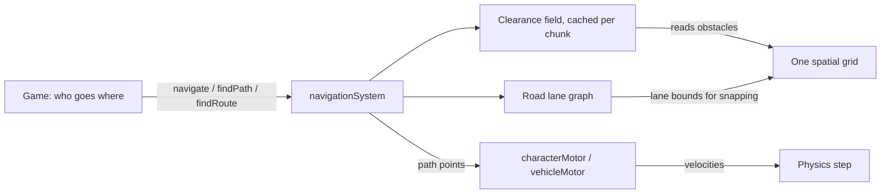

# Navigation

`physics.navigation` gets any body from A to B. People, animals, drones, cars and off-road vehicles all use the same request API. Navigation plans routes, and the existing motors move bodies along them. It never writes positions.

```js
const physics = new physicsSystem();
physics.navigation.navigate(walker, [640, 220]);        // field layer, through the walker's characterMotor
physics.navigation.navigate(taxi, [1200, 80]);          // road layer, through the taxi's vehicleMotor
const path = physics.navigation.findPath({ body: walker, to: [640, 220] });
const route = physics.navigation.findRoute({ from: [10, 0], to: 'harbour_gate' });
```

## Two layers

| Layer | For | Data |
|---|---|---|
| `field` | Anything that moves through open space: people, crowds, companions, animals, drones, a car leaving the road. | Derived from scenery and props in the world's spatial grid. No authoring needed. |
| `road` | Lane-bound travel: cars, buses, taxis, trams, or pedestrian crossings if you author them. | An authored lane graph (`physics.navigation.roads`), normally loaded from Directory data. |

A **profile** picks the layer. `walker` (field) and `car` (road) exist by default. Add more with `registerProfile`. `navigate` picks `car` for bodies with a vehicle motor and `walker` for all others.



## The clearance field

The field divides space into square cells (`cell_size`, default 8 units), grouped into chunks (`chunk_cells`, default 32×32 cells). For every cell centre, a chunk stores the **exact distance to the nearest obstacle**, capped at `max_clearance` (default 64). Every agent radius uses this one field. An agent of radius *r* simply needs enough clearance, so the field never needs a separate inflated copy per agent size.

- **Obstacles** are active, physical, non-ghost bodies in `obstacle_groups` (default `STATIC | PROP`). Characters are never obstacles. The default groups also leave out vehicles and projectiles. Moving bodies are handled by the motors' local avoidance (`personal_space`).
- **Lazy, incremental rebuilds.** A chunk is only built the first time a search touches it. When an obstacle appears, moves, turns, changes group or is removed, the world's own synchronisation marks only the chunks within `max_clearance` of its old and new bounds as dirty. Those chunks rebuild on the next search that needs them, so many edits between two searches cost one rebuild. Doors opening and furniture being pushed are handled this way.
- **One spatial service.** A rebuild reads obstacles from the world's one `spatialGrid`. The field stores no body references or memberships; it is a cache of distances, not a second index of bodies.

## Path planning

`findPath` runs a grid A* over the field and then pulls the result tight.

- **Safe by construction.** A straight segment of length *L* is clear for a circle of radius *r* if both of its ends have at least √(r² + (L/2)²) of clearance. Cell-to-cell steps use this rule with exact centre distances, so the raw search needs no geometry tests. Smoothed segments are checked against cell-centre values (clearance changes by at most the distance moved). That test proves most segments clear or blocked directly; only grazing cases fall back to one exact segment-against-obstacle check. Every returned segment is clear of field obstacles.
- **No per-node allocation.** Search scratch arrays are pooled and stamped between searches.
- **Bounded, then widened.** The first search covers the start/goal box plus a margin. If that area runs out without reaching the goal, the detour lies outside it, so the margin widens (up to three times, ×4 each). An explicit `search_margin` disables widening. `max_nodes` caps the total work.
- **Heuristic weight.** The default `heuristic_weight: 1.2` keeps raw paths within 1.2× optimal (string pulling shortens them again). It expands far fewer cells on long trips. Pass `1` for exactly optimal grid paths.
- **Blocked destinations.** By default a destination inside an obstacle returns `null`. With `allow_partial: true`, the path ends at the nearest open point (or the closest point reached if the goal cannot be reached) and is flagged `partial`.

### Reuse, repair and memo

Paths record the chunk revisions they depend on.

- `findPath({..., reuse: previous})` returns `previous` itself (flagged `reused`) when its goal, radius and every dependency are unchanged. That check costs microseconds. `characterMotor` passes its current path on every replan, so walkers keep their progress and stop re-searching while nothing changes nearby.
- If the goal moved by up to two cells (following a target) and the last leg is still clear, only that leg is replaced.
- A small memo (`memo_size`, default 256) shares results between requests from the same start cell to the same goal, such as a crowd heading for one door. Each caller gets its own copy, and its first leg is rechecked from where it stands.

## Road network

```js
const roads = physics.navigation.roads;
roads.addNode('a', { position: [0, 0] });
roads.addNode('b', { position: [500, 0] });
roads.addLane('main_st', { from: 'a', to: 'b', two_way: true, speed_limit: 180, points: [[250, 20]] });
roads.setLaneOpen('main_st:reverse', false);        // roadworks
const route = physics.navigation.findRoute({ from: [30, 5], to: [470, 5] });
// { points, lanes, length, travel_seconds, revision }
```

- Lanes are directed polylines between junction nodes. `two_way: true` also adds `${lane_id}:reverse`.
- Routes minimise travel time (`length / speed_limit × cost_scale`) with A*. Each lane lists the `profiles` allowed to use it (default `['car']`).
- Each end snaps to the nearest open, permitted lane within `near_range`. Snapping is a query on the world's spatial grid, where lane bounds are stored as non-physical entries. Up to `max_candidates` (default 4) lanes per end are compared, so either direction of a multi-lane two-way street can be chosen (a lane that only leads to a dead end is never the only option).
- All candidate ends go into one multi-source, multi-target A*, which stops once nothing left can beat the best complete route. Results are cached per profile and snapped ends (least recently used, `cache_size` default 2048). Any network change clears the cache.
- Lanes and nodes are saved in physics snapshots. Signals, crossing reservations and following distance stay with the `trafficController`. A vehicle can follow a navigated route with `followPath`, or the game can register the route with traffic.

## API

### `navigationSystem` (`physics.navigation`)

Constructor options come from `new physicsSystem({ navigation: { field: {...}, memo_size } })`.

| Method | Result |
|---|---|
| `navigate(body, to, {profile?, speed?, arrival_distance?, radius?, ...findPath options})` | Plans and starts travel. Characters on the field call `moveTo` on their motor. Vehicles follow a road route, or a field path with a field profile. Returns `{layer, points, ...}`, or `null` after emitting `movementBlocked` (`no_path` / `no_route`). `to` is a point, or a body for field travel. |
| `findPath({body OR collision_shape OR radius, from?, to, max_nodes=20000, search_margin?, allow_partial=false, heuristic_weight=1.2, smooth=true, reuse?})` | `{points, length, partial, visited_nodes, goal, radius, reused, dependencies}`, or `null`. `physics.findPath` is the same method. |
| `findRoute({body OR from (point or node id), to (point or node id), profile='car', near_range?, max_candidates=4})` | `{points, lanes, length, travel_seconds, revision}`, or `null`. |
| `registerProfile(name, {layer:'field'|'road', near_range=200, radius?})` / `getProfile(name)` | Named travel profiles; saved with the world. |
| `agentRadius(body_or_shape)` | Radius used for field planning: a circle's radius (plus offset), otherwise the shape's reach. |
| `configureField({cell_size, chunk_cells, max_clearance, obstacle_groups})` | Replaces field settings; cached chunks are discarded. Returns the active config. |
| `invalidateRegion(bounds)` | Marks chunks dirty, for blockers the field cannot see (for example a change of `obstacle_groups` policy). |
| `getStatistics()` | Request, reuse, memo and repair counts, plus `field`, `planner` and `roads` statistics. |
| `field` / `roads` | The `navigationField` and `roadNetwork` below. |

### `navigationField`

| Method | Result |
|---|---|
| `clearanceAtCell(gx, gy)` | Exact (capped) obstacle distance at a cell centre; builds or rebuilds the chunk if needed. |
| `clearanceAt(point)` | Lower bound of clearance at any point. |
| `exactSegmentClearance(a, b, limit=max_clearance)` | Exact distance from a segment (or a point, with `a = b`) to field obstacles, capped at `limit`. |
| `cellOf(value)` / `cellCenter(index)` | Convert between world coordinates and cell indices. |
| `chunk(cx, cy)` / `chunkRevision(key)` | A current chunk record / a built chunk's revision, or `-1` if it is missing or dirty. |
| `isObstacle(record)` | The obstacle rule above. |
| `invalidateRegion(bounds)` / `invalidateAll()` | Mark chunks dirty. |
| `getConfig()` / `getStatistics()` / `revision` | Settings; build, reuse, dirty-mark and exact-check counters; edit counter. |

### `roadNetwork` (`physics.navigation.roads`)

| Method | Result |
|---|---|
| `addNode(node_id, {position})` | Registers a junction. |
| `addLane(lane_id, {from, to, points=[], speed_limit=180, cost_scale=1, profiles=['car'], two_way=false, open=true})` | Registers one directed lane, or two. Returns their ids. |
| `removeLane(lane_id)` / `setLaneOpen(lane_id, open)` | Edit the network; routing caches clear. |
| `getLane(lane_id)` / `getNode(node_id)` | Detached copies, or `null`. |
| `snapToLane(position, {profile='car', near_range=200}, results?)` | Nearest permitted open lane `{lane, along, position, distance}`; with `results`, all of them sorted by distance. |
| `findRoute({from, to, profile, near_range, max_candidates})` | As `navigationSystem.findRoute`, without profile lookup. |
| `getStatistics()` / `revision` | Requests, cache hits, searches, snaps, sizes. |

## Performance

`node benchmarks/navigation.mjs` builds a seeded 12×12 city-block layout (720 static bodies, about 3.4k × 3.4k units) and times walker queries (radius 10). It also times the previous `findPath`, which tested every A* edge with a shape cast, as a reference. On the development container (Node 22):

| Case | Mean per query |
|---|---|
| Short trips (≤ 500 units), chunks built on first use | ~0.5 ms |
| Short trips, chunks already built | ~0.3 ms |
| Long trips (≤ 3000 units), weight 1.2 | ~2.3 ms |
| Long trips, weight 1 (optimal) | ~3.5 ms; paths 1.5% shorter |
| Reusing an unchanged path | ~0.004 ms |
| Previous shape-cast `findPath`, short trips | ~35 ms; failed 3 of 40 |

These are local measurements, not game frame-rate claims. Measure real scenes on target devices.

## Limits and next steps

- The field is 2D and single-layer. Overlapping floors need separate worlds, or a level-specific obstacle policy.
- Field obstacles are global for all agents. Per-agent collision masks are not applied to planning (the old search respected them). A body that is itself a field obstacle (a pushable prop) bakes its own footprint around its start.
- Long trips across a large city are bounded by `max_nodes`. A hierarchical layer (chunk portals with cached links between them) and per-step planning budgets are the next speed steps.
- Roads have no turn restrictions or per-turn costs yet. Signals and crossings stay in `trafficController`.
