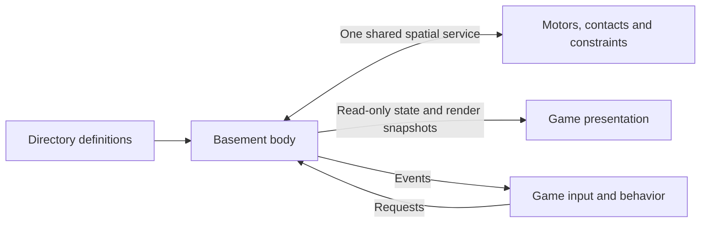

# What live body ownership means

Here, **live** means the implementation running in the playable `DFAB V8.html`, rather than the independent ESM preview. **Body ownership** means responsibility for authoritative physical state and its evolution. It is separate from whether a player owns a car in the story or garage.

A body has a current position, rotation, linear/angular velocity, shape, mass, filters and locks. In the official design, Basement stores and changes that state. A registered game entity owns gameplay identity and a handle to its physical component. It can request movement, impulses, placements and configuration changes; it cannot maintain its own competing physical state or perform collision response.

A player may own a car, while Basement owns that car's physical body. The game chooses the driver, destination, mission, dialogue, damage policy and paint. The engine determines the resulting motion and contacts. Previous poses used for interpolation are engine history; they are not a second game-owned simulation.

## Current live game versus the official implementation

The live legacy `GameEntity` still stores writable `x`, `y`, `vx`, `vy` and rotation-related fields. Traffic, character and collision paths still write those fields. Moving a helper into Basement does not, by itself, make the live body's state engine-owned.

Official `gameEntity` instances instead register an authoritative engine body by construction. `position` and velocity getters return detached/frozen state, and render snapshots cannot alter simulation state. Legacy physical aliases are rejected. The vehicle and pedestrian ESM clients already use this design. The playable apartment now uses this ownership design, including its player, props, doors, lights and curtains. Other scenes retain legacy ownership. See [the apartment cutover](APARTMENT-CUTOVER.md) for scope and remaining parity work.

A body synchronized from an old game object into another physics world would retain two competing authorities. That bridge is not part of this migration. The actual player, scenery, vehicles, pedestrians and projectiles must interact in one official session world before the old collision paths can be removed.

## Example: a seated character

The old passenger update obtains a seat point and copies it into the character's `x/y` each frame. That gives the game update responsibility for the passenger's physical pose.

The official vehicle now asks `physics.attachBody(passenger,{parent_body:car,local_position,local_rotation})`. The passenger keeps its original body and entity IDs. Basement stores the relationship, derives the canonical pose/point velocity, suspends independent dynamics and on-foot contacts, and maintains the same shared-grid entry. Game-side seat rosters contain identity IDs only.

Mounting does not give the car's gameplay object permission to integrate a passenger. Both bodies remain owned by the engine. Interpolated child poses are composed from the interpolated parent pose, so turning does not detach the rendered occupant from its seat.

Leaving is another request: the game supplies authored exit candidates; the engine checks endpoint and path clearance before detaching. Blocked exits retain the relationship. Parent removal releases the existing child body rather than creating a replacement. Configured filters and mass are never copied into a game-side backup.

`combine_mass:true` optionally makes a mounted body contribute to its parent's effective mass, center of mass and rotational inertia. Configured masses stay on their original bodies. Basement caches the derived assembly properties, applies impulses about the aggregate center and uses bounded motor force/torque budgets. A child force/impulse request routes to the assembly at the child's position when every intervening link combines mass. Noncombining links isolate their subtrees; no descendant is counted twice. `getMassProperties(body)` exposes a detached diagnostic snapshot. Combined release inherits velocity by default; an explicit stop remains available.

A rigid mount does not swing independently or enable separate child contacts. Physical joints provide that relative motion. Character facing can use torque-limited physical turning through `movement.physical_turning:true`. Authored local-pose changes and checked exit repositioning remain explicit placements, so they are not claimed to conserve the orbital momentum of a physically simulated relocation.

A garage replacement currently requires releasing mounted bodies first. It rejects an occupied replacement before creating/removing any body. Automatic passenger transfer between replacement models is not implemented yet.

## Completion criteria

- Every active game-world physical entity has one official engine body and identity.
- Directory supplies authored shapes, tuning, seat layouts and other asset definitions.
- Game behavior issues requests and consumes events, without physical position/velocity integration or collision response.
- Queries and culling use the one shared spatial service.
- Lobby advances the world once; render interpolation never writes back into physical state.
- Old constructors, private sensing grids, collision passes and physical-field restore paths are retired after their consumers are switched.

The current cutover ledger remains the authoritative progress record. New attachment support and browser tests demonstrate the official ownership model; they do not claim that the live legacy passenger loop or the rest of the game's physics has already been removed.
