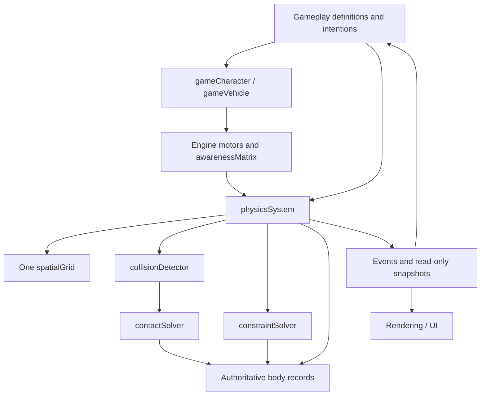

# Architecture and ownership

One `physicsSystem` is one world. It constructs exactly one `spatialGrid`. Independent worlds in tests or a validation load each have their own index; subsystems inside a world never construct another.

## Concerns

| Directory | Owner |
|---|---|
| `core/` | World lifecycle, validation, authoritative body state, integration, events and save/load. |
| `core/mass.mjs` | Cached aggregate mass/center/inertia, center-based integration and impulse/rotation helpers shared by contacts, joints and motors. |
| `spatial/` | Incremental spatial membership and shared spatial/clearance queries. |
| (sibling package) `../maps/` | Map definitions to entities, exterior region streaming, door control and the room graph. Uses this package's public API only. |
| `navigation/` | Clearance field, grid path planning with reuse, road lane graph and travel profiles. |
| `collision/` | Immutable shapes, contact/sweep geometry and mass-aware contact solving. |
| `constraints/` | Hinges, distance/spring/attachment/drag constraints. |
| `attachments/` | Prescribed parent-local mounts of existing bodies, checked exits and composed render interpolation. |
| `motors/` | Character, vehicle, path and projectile intentions translated into physical motion. |
| `particles/` | Pools, chains and owned cloth edge meshes using shared bodies, constraints and contacts. |
| `traffic/` | Cached itineraries, signals, crossing/passing reservations; shared-index motion prediction. |
| `motion/` | Engine-owned timelines/orbits issuing ordinary body velocities. |
| `elements/` | Thin game-facing vocabulary and awareness queries. |
| `examples/` | Clients of the public API; they contain rendering/input glue, not physics responses. |
| `tests/`, `benchmarks/` | Executable contract checks, geometry/grid equivalence and measurements. |

`physicsBody` is a handle. Its authoritative data is held in a module-private WeakMap. Its public identity is immutable, position/velocity properties return frozen snapshots, and `getState` returns a detached copy. There is no writable mirror on a game element. `gameCharacter.physics_controller.body` and `fetchBody(id)` refer to that same body.

`gameEntity` is the official world-element base, with automatic component creation/registration, lifecycle, scoped events and asset bindings. `gameElements` owns the identity registry. Specialized elements inherit the base instead of wrapping old game objects. Their root entity/body IDs coincide, and the identity registry contains no physical-state copies or geometry. Its data comes from a data source it is handed, normally the Directory's registry; the Basement never imports the Directory. See [entities](entities.md).

Controllers are engine components. A character, traffic path follower, projectile and particle do not maintain alternative body stores, grids, detection or impulse implementations. Internal methods prefixed `_` and modules below `index.mjs` are engine implementation details; clients should import only the public entry point.

Prescribed mounts retain the child's canonical body record and configured mass/filters. The attachment manager stores a parent reference and authored local pose, derives motion from the parent, and suspends the child's independent integration and physical contacts. It maintains the same spatial membership, composes render poses from parent interpolation, and checks exit paths before restoring independent motion. With `combine_mass:true`, cached subtree mass, center and inertia contribute to the parent assembly, and explicit child force/impulse requests route to its independent root. Noncombining links isolate their mass subtree. Child collision shapes still do not generate independent contacts while mounted. Physical joints allow independent relative motion instead. Pending reservations prevent duplicate mounts and cycles before event-time commands commit.

## Shared index

The grid has two levels: ordinary cells and a coarse level (8× larger cells) for entries spanning more than 16 cells, so large scenery does not fill hundreds of cells. Membership changes incrementally when bounds cross cell boundaries, retaining shared cells and updating only the entering/leaving strips. Unchanged collision/render/light bounds are cached by canonical pose/shape; idle records skip grid synchronization work. Static geometry is not rebuilt every frame. Rotated shapes use actual transformed bounds, including compound children. During prediction, moving bodies have conservative swept bounds so two objects crossing between endpoints can be found. Final bounds are restored after solving.

Queries reuse one index. Radius/bounds queries visit relevant cells; segment and thick sweep queries traverse a corridor using DDA instead of scanning a diagonal bounding rectangle. Result buffers can be supplied by callers. The index returns conservative candidates; exact geometry and masks are evaluated in the query/detection layer.

Nonphysical objects can register spatial metadata through `registerSpatialInstance`. Rendering/culling can query these and body handles through the same index. Navigation keeps a derived clearance field: per-chunk distances from cell centres to the nearest obstacle, built lazily from shared-index queries and marked dirty by the world's own body synchronisation. It stores no body references or memberships, and it is never used for collision candidates. Road lanes register their bounds as nonphysical entries in the same index. See [navigation](navigation.md).

Body integration is O(moving bodies), not a collision test. Pair generation visits nearby candidates and deduplicates unordered pairs. Candidate lists are reused until shared-grid, collision pose/sweep, filter or attachment inputs change. This remains correct when a large light/render extent hides physical motion from the index AABB. Exact contact response and contact lifecycle events still run for the valid candidate pairs. Genuine dense overlaps still have a quadratic number of pairs; no index can make actual pairwise interactions disappear. Iteration stops early when neither contacts nor constraints require another pass. See `benchmarks/spatial.mjs` for candidate counts and local timings; no game/device FPS improvement is claimed before migration measurements.

## Simulation and frontend boundary

The Lobby will call `updateState` at its fixed timestep. The world commits queued requests, evaluates motors/forces, resolves existing contacts before travel, predicts motion, processes ordered projectile sweeps, generates contacts, solves contacts/constraints, updates sleeping/lifetimes and then delivers events. Callback requests take effect at the next step boundary. Rendering reads `getRenderState`; interpolation never overwrites live physical state.

Gameplay selects targets, routes, damage and effects. The engine calculates directions, clearance, stopping, separation, impulse, torque and integration. Rendering can perform drawing/camera arithmetic; it cannot change body positions to resolve a physical situation.

[Incremental spatial diagnostics, verification and measurements](spatial-performance.md) describe invalidation and the remaining simulation costs.
